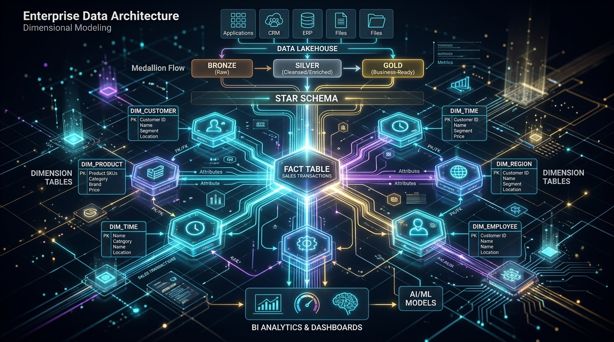
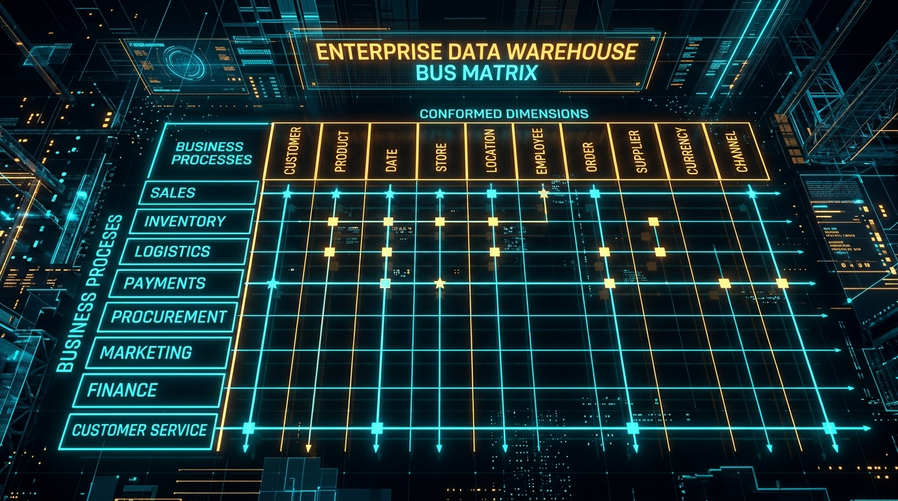

# ENTERPRISE DATA MODELING MASTERCLASS
## The Senior Data Architect Blueprint: GlobalMart Case Study



> **Document Type:** Interactive Architectural Reference & Masterclass Guide  
> **Target Audience:** Data Engineers, Analytics Engineers, Data Architects, Senior Technical Leads  
> **Domain Focus:** Conceptual & Logical Modeling, Fact & Dimension Design, Bus Matrix Architecture  
> **Source Grounding:** 100% Exhaustive Coverage of the 78-Part GlobalMart Master Specification  
> **Design Philosophy:** Pure Architectural Schematics, Flowcharts, Decision Trees, and Data Structures (Zero SQL Noise)

---

## TABLE OF CONTENTS

1. [MASTER CASE STUDY: GLOBALMART ENTERPRISE PROFILE](#master-case-study-globalmart-enterprise-profile)
2. [PART 1 — THE BUSINESS REQUIREMENTS](#part-1--the-business-requirements)
   - [Sales Team Requirements](#sales-team-requirements)
   - [Finance Team Requirements](#finance-team-requirements)
   - [Logistics & Supply Chain Requirements](#logistics--supply-chain-requirements)
   - [Inventory Management Requirements](#inventory-management-requirements)
   - [Procurement & Vendor Requirements](#procurement--vendor-requirements)
   - [Returns & Reverse Logistics Requirements](#returns--reverse-logistics-requirements)
   - [Marketing & Campaign Requirements](#marketing--campaign-requirements)
   - [Customer Support Requirements](#customer-support-requirements)
   - [Executive Dashboard Requirements](#executive-dashboard-requirements)
3. [PART 2 — YOUR FIRST JOB IS NOT TABLE DESIGN](#part-2--your-first-job-is-not-table-design)
4. [PART 3 — WHY BUSINESS PROCESS COMES FIRST](#part-3--why-business-process-comes-first)
5. [PART 4 — BUILD A BUS MATRIX](#part-4--build-a-bus-matrix)
6. [PART 5 — NOW DESIGN ONE PROCESS AT A TIME: SALES](#part-5--now-design-one-process-at-a-time-sales)
7. [PART 6 — BUILD FACTSALES](#part-6--build-factsales)
8. [PART 7 — WHY DID WE NOT PUT PRODUCT NAME IN FACTSALES?](#part-7--why-did-we-not-put-product-name-in-factsales)
9. [PART 8 — DESIGN THE SALES DIMENSIONS](#part-8--design-the-sales-dimensions)
10. [PART 9 — OUR SALES STAR SCHEMA](#part-9--our-sales-star-schema)
11. [PART 10 — THE PAYMENT PROCESS](#part-10--the-payment-process)
12. [PART 11 — WHY PAYMENT DOES NOT BELONG IN FACTSALES](#part-11--why-payment-does-not-belong-in-factsales)
13. [PART 12 — DELIVERY PROCESS](#part-12--delivery-process)
14. [PART 13 — DELIVERY STAR SCHEMA & ROLE-PLAYING DIMENSIONS](#part-13--delivery-star-schema--role-playing-dimensions)
15. [PART 14 — INVENTORY PROCESS](#part-14--inventory-process)
16. [PART 15 — WHY PERIODIC SNAPSHOT?](#part-15--why-periodic-snapshot)
17. [PART 16 — PROCUREMENT PROCESS](#part-16--procurement-process)
18. [PART 17 — PROCUREMENT DOES NOT END AT ORDERING: GOODS RECEIPT](#part-17--procurement-does-not-end-at-ordering-goods-receipt)
19. [PART 18 — RETURNS PROCESS](#part-18--returns-process)
20. [PART 19 — CUSTOMER SUPPORT PROCESS](#part-19--customer-support-process)
21. [PART 20 — CUSTOMER ACTIVITY & DERIVED BEHAVIORAL FACTS](#part-20--customer-activity--derived-behavioral-facts)
22. [PART 21 — MARKETING PERFORMANCE: QUESTION ≠ FACT TABLE](#part-21--marketing-performance-question--fact-table)
23. [PART 22 — CATALOG OF ENTERPRISE FACTS](#part-22--catalog-of-enterprise-facts)
24. [PART 23 — SHARED DIMENSIONS](#part-23--shared-dimensions)
25. [PART 24 — WHAT DOES "CONFORMED" REALLY MEAN?](#part-24--what-does-conformed-really-mean)
26. [PART 25 — THE GLOBALMART ENTERPRISE MULTI-STAR MODEL](#part-25--the-globalmart-enterprise-multi-star-model)
27. [PART 26 — WHY DO WE NEED DIMENSION KEYS?](#part-26--why-do-we-need-dimension-keys)
28. [PART 27 — SLOWLY CHANGING DIMENSIONS: SCD TYPE 2](#part-27--slowly-changing-dimensions-scd-type-2)
29. [PART 28 — WHY HISTORICAL PRESERVATION MATTERS](#part-28--why-historical-preservation-matters)
30. [PART 29 — WHEN NOT TO USE SCD TYPE 2](#part-29--when-not-to-use-scd-type-2)
31. [PART 30 — ROLE-PLAYING DIMENSIONS DEEP DIVE](#part-30--role-playing-dimensions-deep-dive)
32. [PART 31 — DEGENERATE DIMENSIONS](#part-31--degenerate-dimensions)
33. [PART 32 — JUNK DIMENSIONS](#part-32--junk-dimensions)
34. [PART 33 — BRIDGE TABLES & MANY-TO-MANY RELATIONSHIPS](#part-33--bridge-tables--many-to-many-relationships)
35. [PART 34 — ADVANCED BRIDGE TABLE SCENARIO: SUPPLIERS & PRODUCTS](#part-34--advanced-bridge-table-scenario-suppliers--products)
36. [PART 35 — FACTLESS FACT TABLES](#part-35--factless-fact-tables)
37. [PART 36 — ACCUMULATING SNAPSHOT FACT TABLES](#part-36--accumulating-snapshot-fact-tables)
38. [PART 37 — PERIODIC SNAPSHOT VS ACCUMULATING SNAPSHOT](#part-37--periodic-snapshot-vs-accumulating-snapshot)
39. [PART 38 — TRANSACTION FACT TABLES](#part-38--transaction-fact-tables)
40. [PART 39 — ADDITIVE VS SEMI-ADDITIVE MEASURES](#part-39--additive-vs-semi-additive-measures)
41. [PART 40 — NON-ADDITIVE MEASURES & MATHEMATICAL PITFALLS](#part-40--non-additive-measures--mathematical-pitfalls)
42. [PART 41 — FACT TABLE GRANULARITY CATALOG](#part-41--fact-table-granularity-catalog)
43. [PART 42 — THE SACRED "ONE ROW =" TEST](#part-42--the-sacred-one-row--test)
44. [PART 43 — DECIDING WHAT COLUMNS GO INTO A FACT TABLE](#part-43--deciding-what-columns-go-into-a-fact-table)
45. [PART 44 — DECIDING WHAT BECOMES A DIMENSION](#part-44--deciding-what-becomes-a-dimension)
46. [PART 45 — DECIDING WHAT BECOMES A FACT](#part-45--deciding-what-becomes-a-fact)
47. [PART 46 — DECIDING WHETHER TWO THINGS BELONG IN ONE FACT](#part-46--deciding-whether-two-things-belong-in-one-fact)
48. [PART 47 — WHY NOT CREATE A FACT FOR EVERY QUESTION?](#part-47--why-not-create-a-fact-for-every-question)
49. [PART 48 — WHEN AN AGGREGATE FACT TABLE MAKES SENSE](#part-48--when-an-aggregate-fact-table-makes-sense)
50. [PART 49 — DO NOT CONFUSE AGGREGATE WITH ATOMIC DATA](#part-49--do-not-confuse-aggregate-with-atomic-data)
51. [PART 50 — ADVANCED DIMENSION DESIGN & HIERARCHIES](#part-50--advanced-dimension-design--hierarchies)
52. [PART 51 — WHY DIMENSIONS CAN BE EXTREMELY WIDE](#part-51--why-dimensions-can-be-extremely-wide)
53. [PART 52 — STAR VS SNOWFLAKE DIMENSION DESIGN](#part-52--star-vs-snowflake-dimension-design)
54. [PART 53 — DATA MODEL VS PHYSICAL STORAGE](#part-53--data-model-vs-physical-storage)
55. [PART 54 — ENTERPRISE LAKEHOUSE ARCHITECTURE](#part-54--enterprise-lakehouse-architecture)
56. [PART 55 — WHAT THE SILVER LAYER ACTUALLY DOES](#part-55--what-the-silver-layer-actually-does)
57. [PART 56 — WHAT THE GOLD LAYER ACTUALLY DOES](#part-56--what-the-gold-layer-actually-does)
58. [PART 57 — MODERN 2026 ARCHITECTURAL PARADIGM](#part-57--modern-2026-architectural-paradigm)
59. [PART 58 — DATA QUALITY ENFORCEMENT & REFERENTIAL INTEGRITY](#part-58--data-quality-enforcement--referential-integrity)
60. [PART 59 — LATE-ARRIVING DATA & UNKNOWN MEMBERS](#part-59--late-arriving-data--unknown-members)
61. [PART 60 — SCD POINT-IN-TIME LOOKUP DURING FACT LOADING](#part-60--scd-point-in-time-lookup-during-fact-loading)
62. [PART 61 — HANDLING DUPLICATE SOURCE RECORDS](#part-61--handling-duplicate-source-records)
63. [PART 62 — HANDLING PIPELINE RETRIES & IDEMPOTENCY](#part-62--handling-pipeline-retries--idempotency)
64. [PART 63 — HANDLING ORDER CANCELLATIONS & STATUS MUTATIONS](#part-63--handling-order-cancellations--status-mutations)
65. [PART 64 — WHY BUSINESS REQUIREMENTS DRIVE ARCHITECTURAL COMPLEXITY](#part-64--why-business-requirements-drive-architectural-complexity)
66. [PART 65 — THE SACRED KIMBALL DESIGN WORKFLOW](#part-65--the-sacred-kimball-design-workflow)
67. [PART 66 — THE 5 QUESTIONS THAT SOLVE 95% OF MODELING PROBLEMS](#part-66--the-5-questions-that-solve-95-of-modeling-problems)
68. [PART 67 — THE MASTER FACT-TABLE DECISION TREE](#part-67--the-master-fact-table-decision-tree)
69. [PART 68 — THE BIGGEST TRAPS TO AVOID](#part-68--the-biggest-traps-to-avoid)
70. [PART 69 — SOURCE TABLE ≠ FACT TABLE](#part-69--source-table--fact-table)
71. [PART 70 — GOLD LAYER DOES NOT MIRROR SILVER](#part-70--gold-layer-does-not-mirror-silver)
72. [PART 71 — HOW TO AUDIT & STRESS-TEST YOUR MODEL](#part-71--how-to-audit--stress-test-your-model)
73. [PART 72 — THE ULTIMATE TEST: CAN MY MODEL ANSWER THE REQUIREMENTS?](#part-72--the-ultimate-test-can-my-model-answer-the-requirements)
74. [PART 73 — THE FUNDAMENTAL "WHY" OF STAR SCHEMA](#part-73--the-fundamental-why-of-star-schema)
75. [PART 74 — THE MODERN SEMANTIC LAYER](#part-74--the-modern-semantic-layer)
76. [PART 75 — THE PRINCIPAL DATA ENGINEER MENTAL MODEL](#part-75--the-principal-data-engineer-mental-model)
77. [PART 76 — THE ENTIRE GLOBALMART ENTERPRISE BLUEPRINT](#part-76--the-entire-globalmart-enterprise-blueprint)
78. [PART 77 — THE 20 GOLDEN RULES OF DIMENSIONAL MODELING](#part-77--the-20-golden-rules-of-dimensional-modeling)
79. [PART 78 — THE FINAL ARCHITECTURAL SYNTHESIS](#part-78--the-final-architectural-synthesis)

---

# MASTER CASE STUDY: GLOBALMART ENTERPRISE PROFILE

To understand high-level enterprise data modeling, we study **GlobalMart**—a multinational hyper-scale omnichannel retail enterprise.

```
┌──────────────────────────────────────────────────────────────────────────────┐
│                         GLOBALMART ENTERPRISE SCALE                          │
├──────────────────────────────────────────────────────────────────────────────┤
│  • Geography:            50+ Countries across 6 Continents                   │
│  • Physical Footprint:   20,000+ Stores & Supercenters                       │
│  • Supply Chain Hubs:    500+ Distribution Centers & Regional Fulfillment    │
│  • Customer Base:        100,000,000+ Active Customers                       │
│  • Catalog Breadth:      10,000,000+ Active SKUs / Products                  │
│  • Transaction Volume:   Billions of Sales Line Items annually               │
│  • Payment Volume:       Hundreds of Millions of Payment Transactions        │
│  • Fulfillment:          Tens of Millions of Delivery Legs                   │
│  • Reverse Logistics:    Millions of Return Events                           │
│  • Telemetry & State:    Billions of Daily Inventory Observations            │
└──────────────────────────────────────────────────────────────────────────────┘
```

### Omnichannel Sales Surfaces
GlobalMart generates transactions across four distinct channels:
1. **Desktop & Mobile Web Application**
2. **Native iOS & Android Mobile Apps**
3. **Brick-and-Mortar Physical Stores (Point of Sale)**
4. **Third-Party Marketplace Partners & Affiliates**

### Operational Ecosystem
- **Customer Service Centers:** Live chat, telephony, automated ticket routing.
- **Logistics & Warehousing:** Automated sorting facilities, cross-docking hubs.
- **Delivery Fleets:** Proprietary last-mile couriers and 3rd-party logistics (3PL).
- **Vendor Network:** Global manufacturers, local agricultural suppliers, drop-shippers.
- **Commercial Programs:** Loyalty tiers, personalized coupons, seasonal promotions.

---

# PART 1 — THE BUSINESS REQUIREMENTS

A junior engineer begins by creating tables in a database. A **Senior Data Architect** begins by systematically reading and classifying the business requirements from every operating division.

Below is the verbatim business requirement portfolio given to the data engineering team:

```
┌─────────────────────────────────────────────────────────────────────────────┐
│                          GLOBALMART BUSINESS TEAMS                          │
├──────────────────────┬──────────────────────┬───────────────────────────────┤
│ 1. Sales Operations  │ 4. Inventory Ops     │ 7. Marketing Analytics        │
│ 2. Treasury/Finance  │ 5. Procurement       │ 8. Customer Care (Support)    │
│ 3. Logistics & Fleet │ 6. Reverse Logistics │ 9. Executive Leadership (CEO) │
└──────────────────────┴──────────────────────┴───────────────────────────────┘
```

---

## Sales Team Requirements

The sales leadership demands multi-dimensional revenue decomposition:

```
BUSINESS QUESTIONS (SALES):
  • "What is total revenue broken down by Country, Region, City, and Store?"
  • "Which Products, Brands, Subcategories, and Departments drive gross revenue?"
  • "How does revenue differ across Customer Segments and Loyalty Tiers?"
  • "What is sales velocity across Digital Channels vs. Physical Stores?"
  • "Which Marketing Promotions generated incremental sales lift?"
  • "What are the sales trends by Day of Week, Month, Quarter, and Fiscal Year?"

REQUIRED METRICS:
  • Quantity Sold (units)
  • Gross Sales Amount (Price × Quantity)
  • Discount Amount (Promotional concessions)
  • Tax Collected (Sales/VAT)
  • Net Sales Amount (Gross - Discount)
  • Cost of Goods Sold (Unit Cost × Quantity)
  • Gross Margin / Profit Amount (Net Sales - COGS)
```

---

## Finance Team Requirements

The corporate treasury and accounting teams are not analyzing what items were bought; they are tracking money movement, settlement risk, and transaction failure rates:

```
BUSINESS QUESTIONS (FINANCE):
  • "How many total payment attempts occurred, and what percentage succeeded?"
  • "What are the specific technical and banking failure reasons for declined payments?"
  • "What is our payment provider volume split (Stripe vs Adyen vs PayPal vs Visa)?"
  • "What total processing fees did we pay to card networks and acquirers?"
  • "What was the actual settled cash amount collected in bank accounts?"
  • "What refund amounts were disbursed back to original payment methods?"

REQUIRED METRICS & ATTRIBUTES:
  • Payment Attempts (Count)
  • Payment Successes vs Failures (Counts)
  • Failure Reasons (Insufficient Funds, Card Expired, Fraud Flag, Gateway Timeout)
  • Payment Methods (Credit, Debit, Digital Wallet, Cash, Gift Card, BNPL)
  • Payment Processing Gateway / Provider
  • Merchant Processing Fees (Currency)
  • Settled Amount (Currency)
  • Refund Amount Disbursed (Currency)
```

---

## Logistics & Supply Chain Requirements

The logistics organization is tasked with order fulfillment speed, transportation efficiency, and delivery SLA compliance:

```
BUSINESS QUESTIONS (LOGISTICS):
  • "What is the average order fulfillment cycle time from placement to doorstep?"
  • "How long do distribution centers take to pick, pack, and stage orders?"
  • "What is transit time from warehouse dispatch to local carrier hub?"
  • "What percentage of deliveries arrived past the promised delivery SLA date/time?"
  • "How do our 3PL courier partners (FedEx, DHL, Local Couriers) rank in on-time rate?"
  • "What is the cost of last-mile shipping versus delivery fees charged to customers?"

REQUIRED METRICS & ATTRIBUTES:
  • Order Fulfillment Lead Time (Minutes/Hours)
  • Warehouse Packing Duration (Minutes)
  • Dispatch & Transit Duration (Hours)
  • Delivery Duration (Hours)
  • On-Time Flag vs Late Delivery Flag
  • Promised Delivery Timestamp vs Actual Delivery Timestamp
  • Transit Distance (Kilometers)
  • Delivery Freight Cost vs Delivery Fee Charged
```

---

## Inventory Management Requirements

The warehouse and retail operations teams manage working capital trapped in merchandise:

```
BUSINESS QUESTIONS (INVENTORY):
  • "What was our exact stock-on-hand for every SKU at every store at end-of-day?"
  • "How many units were received from suppliers into distribution centers today?"
  • "How many units were deducted via customer sales orders?"
  • "How many units were restored to stock via customer returns?"
  • "How many units were scrapped due to shrinkage, spoilage, or physical damage?"
  • "Which high-velocity SKUs experienced complete stock-outs, and for how many hours?"
  • "What is the total monetary valuation of inventory sitting in each facility?"

REQUIRED METRICS & ATTRIBUTES:
  • Opening Quantity on Hand
  • Quantity Received from Suppliers
  • Quantity Sold to Customers
  • Quantity Returned by Customers
  • Quantity Damaged / Written Off
  • Closing Quantity on Hand
  • Total Valuation Amount (Closing Quantity × Current Unit Cost)
  • Out-of-Stock Flag
```

---

## Procurement & Vendor Requirements

The merchandising and supplier management division tracks supplier reliability and purchase commitments:

```
BUSINESS QUESTIONS (PROCUREMENT):
  • "What purchase orders (POs) have we issued to global suppliers?"
  • "What is the on-time, in-full (OTIF) fulfillment rate for each manufacturer?"
  • "How many units were ordered versus actually received at receiving docks?"
  • "How many received units failed QA inspection and were rejected/quarantined?"
  • "What was our contractual purchase cost versus invoice price?"
  • "What is the vendor lead time between PO creation and dock receipt?"

REQUIRED METRICS & ATTRIBUTES:
  • PO Line Ordered Quantity
  • Goods Receipt Accepted Quantity
  • Goods Receipt Rejected / Defective Quantity
  • Contract Purchase Unit Cost
  • Total Purchase Commitment Amount
  • Vendor Quoted Lead Time vs Actual Dock Receipt Lead Time (Days)
```

---

## Returns & Reverse Logistics Requirements

The returns division monitors customer dissatisfaction, return fraud, and product defects:

```
BUSINESS QUESTIONS (RETURNS):
  • "Which products experience the highest return rates?"
  • "What are the primary return disposition reasons (Wrong Size, Defective, Buyer Remorse)?"
  • "What is the total refund cash disbursed versus store credit issued?"
  • "Are specific customer segments or store locations driving abnormal return spikes?"
  • "What restocking fees are recovered during the reverse supply chain flow?"

REQUIRED METRICS & ATTRIBUTES:
  • Returned Units (Quantity)
  • Gross Refund Amount (Currency)
  • Restocking Fee Deducted (Currency)
  • Return Reason Classification
  • Return Disposition (Restocked to Shelf, Sent to Refurbishment, Destroyed)
```

---

## Marketing & Campaign Requirements

The growth marketing and brand teams measure return on ad spend (ROAS) and customer acquisition cost (CAC):

```
BUSINESS QUESTIONS (MARKETING):
  • "Which promotional campaigns drove the highest revenue lift?"
  • "What total discount dollars were redeemed through coupon codes?"
  • "Which digital channels (Organic Search, Paid Social, Affiliate) acquired new customers?"
  • "What is the 30-day, 90-day, and 365-day customer repeat purchase rate?"
  • "What is the Customer Lifetime Value (LTV) segmented by acquisition channel?"

REQUIRED METRICS & ATTRIBUTES:
  • Campaign Impression Count & Click Count
  • Campaign Direct Attributed Revenue
  • Promotion Discount Amount Redeemed
  • New Customer Acquisition Count
  • Customer Retention & Churn Rate
  • Customer Lifetime Value
```

---

## Customer Support Requirements

The customer operations team manages post-purchase issues, call centers, and customer satisfaction (CSAT):

```
BUSINESS QUESTIONS (CUSTOMER CARE):
  • "How many support tickets are created daily across phone, email, and live chat?"
  • "What percentage of tickets relate to delivery delays vs product defects vs billing errors?"
  • "What is the average first-response time and total resolution time per agent?"
  • "Which agents and support tiers achieve the highest CSAT ratings?"
  • "How many tickets were reopened due to inadequate initial resolution?"

REQUIRED METRICS & ATTRIBUTES:
  • Support Ticket Count
  • Ticket Escalation Count
  • First Contact Resolution Time (Minutes)
  • Total Resolution Duration (Minutes)
  • Reopen Count
  • Customer CSAT Score (1 to 5)
```

---

## Executive Dashboard Requirements

The Chief Executive Officer (CEO) and Board of Directors require a unified, single-pane-of-glass overview:

```
EXECUTIVE DASHBOARD REQUIREMENTS:
  • Global Net Revenue & Gross Margin % (Year-over-Year, Target vs Actual)
  • Daily Active Customers & Transacting Customers
  • Working Capital Locked in Inventory across 500+ DCs
  • Payment Gateway Success Rate & Operational Chargeback Ratio
  • On-Time Delivery Rate across Global Fleet
  • Return Rate % across Major Product Categories
  • Marketing Return on Investment (ROI) & Blended Customer Acquisition Cost
```

> **CRITICAL ARCHITECTURAL PAUSE:**  
> Review all 9 requirement blocks above. Notice something profound:  
> **We have NOT created a single database table yet!**  
> We have NOT written a single column definition.  
> This is intentional. Junior engineers immediately jump to creating tables. Senior Architects stop, observe, and map the enterprise first.

---

# PART 2 — YOUR FIRST JOB IS NOT TABLE DESIGN

When handed hundreds of business requirements, a junior developer asks:  
*"What tables should I create to store these columns?"*

A **Senior Principal Architect** asks:  
# *"What BUSINESS PROCESSES exist in this enterprise?"*

```
┌─────────────────────────────────────────────────────────────────────────────┐
│                           THE FIRST ARCHITECTURAL SHIFT                     │
├─────────────────────────────────────────────────────────────────────────────┤
│                                                                             │
│   ❌ JUNIOR MENTALITY:     Business Requirements ──► Database Tables        │
│                                                                             │
│   ✅ SENIOR MENTALITY:     Business Requirements ──► Business Processes     │
│                                                                │            │
│                                                                ▼            │
│                                                          Grain of Event     │
│                                                                │            │
│                                                                ▼            │
│                                                          Fact Tables        │
└─────────────────────────────────────────────────────────────────────────────┘
```

A **business process** is an operational activity performed by the enterprise, typically supported by an OLTP source system, that generates measurable events or state changes.

From the GlobalMart business requirements, we isolate **10 discrete business processes**:

```
THE 10 GLOBALMART BUSINESS PROCESSES:
  1. Sales Transactions           (Order checkout and product sales)
  2. Payment Processing           (Card authorization, capture, gateway clearing)
  3. Order Fulfillment            (Warehouse picking, packing, and staging)
  4. Parcel Delivery              (Courier transit and final customer doorstep drop)
  5. Inventory State              (Daily stock level balances across facilities)
  6. Purchase Ordering            (Issuing replenishment contracts to suppliers)
  7. Goods Receipt                (Physical dock intake and inspection of vendor shipments)
  8. Customer Returns             (Reverse logistics and refund issuance)
  9. Customer Support             (Contact center ticket interactions and resolution)
 10. Digital Customer Activity    (Session engagement, browsing, and cart additions)
```

This transition from **disorganized business questions** to **discrete business processes** is the cornerstone of Kimball dimensional modeling.

---

# PART 3 — WHY BUSINESS PROCESS COMES FIRST

Suppose management walks into your office and says:  
> *"We need to see revenue by country!"*

A naive developer immediately runs to create:
```
❌ ANTI-PATTERN: Table `FactRevenueByCountry`
```

Why is `FactRevenueByCountry` a catastrophic data modeling mistake?
1. **It models a question, not a business process:** Next week, marketing will ask for *"Revenue by Product"*, then finance will ask for *"Revenue by Payment Provider"*, and management will ask for *"Revenue by Week"*. If you design for questions, you will build 50 fragmented tables that drift out of sync.
2. **It pre-aggregates and destroys detail:** If you store revenue at the Country level, you can never drill down to the Store, Customer, or Product SKU level.
3. **Revenue is not a process; Sales is the process:** Revenue is simply a mathematical metric produced by the **Sales** business process!

The immutable architectural chain that you must burn into memory:

```
┌─────────────────────────────────────────────────────────────────────────────┐
│                   THE SACRED ARCHITECTURAL DESIGN CHAIN                     │
├─────────────────────────────────────────────────────────────────────────────┤
│                                                                             │
│      1. Business Question     ("What is revenue by country and product?")   │
│               │                                                             │
│               ▼                                                             │
│      2. Business Process      (Sales Checkout)                              │
│               │                                                             │
│               ▼                                                             │
│      3. Business Event/State  (Customer bought a specific product line)     │
│               │                                                             │
│               ▼                                                             │
│      4. Atomic Grain          (One row = One product line in one order)     │
│               │                                                             │
│               ▼                                                             │
│      5. Fact Table            (FactSales)                                   │
│               │                                                             │
│               ▼                                                             │
│      6. Dimensions            (DimCustomer, DimProduct, DimStore, DimDate)  │
│                                                                             │
└─────────────────────────────────────────────────────────────────────────────┘
```

By modeling the atomic business process, **a single well-designed fact table (`FactSales`) can answer thousands of different business questions**, including revenue by country, revenue by product, profit by store, margin by promotion, and sales by customer.

---

# PART 4 — BUILD A BUS MATRIX

Before designing individual tables, a Senior Data Architect creates the **Enterprise Data Warehouse Bus Matrix**.

The Bus Matrix is a two-dimensional grid:
- **Rows:** The enterprise **Business Processes**
- **Columns:** The shared **Dimensions** (Context entities)



Here is the GlobalMart Enterprise Bus Matrix:

| Business Process | DimCustomer | DimProduct | DimStore | DimDate | DimPromotion | DimChannel | DimSupplier | DimCourier | DimPaymentMethod | DimReturnReason | DimIssue |
| :--- | :---: | :---: | :---: | :---: | :---: | :---: | :---: | :---: | :---: | :---: | :---: |
| **Sales** | **X** | **X** | **X** | **X** | **X** | **X** | — | — | — | — | — |
| **Payment** | **X** | — | **X** | **X** | — | **X** | — | — | **X** | — | — |
| **Fulfillment** | **X** | **X** | **X** | **X** | — | — | — | **X** | — | — | — |
| **Delivery** | **X** | — | **X** | **X** | — | — | — | **X** | — | — | — |
| **Inventory** | — | **X** | **X** | **X** | — | — | — | — | — | — | — |
| **Procurement (PO)**| — | **X** | **X** | **X** | — | — | **X** | — | — | — | — |
| **Goods Receipt** | — | **X** | **X** | **X** | — | — | **X** | — | — | — | — |
| **Returns** | **X** | **X** | **X** | **X** | — | **X** | — | — | — | **X** | — |
| **Support Tickets**| **X** | **X** | **X** | **X** | — | **X** | — | — | — | — | **X** |
| **Customer Activity**| **X** | — | — | **X** | — | **X** | — | — | — | — | — |

```
LEGEND:
  X = Dimension is attached to this business process fact table
  — = Dimension does not apply at this fact table's grain
```

### Why the Bus Matrix is Critical
1. **Identifies Conformed Dimensions:** Notice that `DimDate`, `DimCustomer`, `DimProduct`, and `DimStore` appear across multiple rows. These are **Conformed Dimensions**—they must be engineered once with consistent keys and attributes across the entire enterprise.
2. **Defines Architectural Boundaries:** It proves immediately that `FactPayment` cannot directly connect to `DimProduct` because payments happen at the order level, not the individual product level.
3. **Provides the Project Roadmap:** You do not build all 10 processes on day one. You implement row by row (e.g., Sales first, then Payments, then Inventory), confident that they will join together seamlessly because the conformed dimensions were pre-planned.

---

# PART 5 — NOW DESIGN ONE PROCESS AT A TIME: SALES

Let us begin with the first business process: **SALES**.

Business Requirement:
> *"We need product-level revenue and profitability analysis broken down by customer, product, store, channel, promotion, and time."*

We execute the rigorous Kimball 4-Step Dimensional Design Process:

```
┌─────────────────────────────────────────────────────────────────────────────┐
│                    KIMBALL 4-STEP DIMENSIONAL DESIGN METHOD                 │
├─────────────────────────────────────────────────────────────────────────────┤
│                                                                             │
│   STEP 1: Select the Business Process   ──►  Sales                          │
│                                                                             │
│   STEP 2: Declare the Grain             ──►  One row = One product line     │
│                                              in one sales order             │
│                                                                             │
│   STEP 3: Identify the Dimensions       ──►  Customer, Product, Store,      │
│                                              Date, Channel, Promotion       │
│                                                                             │
│   STEP 4: Identify the Numeric Facts    ──►  Quantity, Unit Price, Gross,   │
│                                              Discount, Tax, Net, Cost, Profit│
│                                                                             │
└─────────────────────────────────────────────────────────────────────────────┘
```

### Step 1: Select the Business Process
The process is the operational checkout event where a customer purchases goods.

### Step 2: What Happened?
A customer purchased one or more physical/digital items during a checkout session.

### Step 3: What Level of Detail (The Grain)?
The business asks for *"product-level"* revenue analysis.
If an order contains:
- 1 Gallon of Milk
- 1 Loaf of Bread
- 2 Apples

If we declare the grain as *"One row = One Order"*, we cannot record what products were sold!
Therefore, we must declare the most granular atomic grain possible:

# 💎 THE SACRED GRAIN: ONE ROW = ONE PRODUCT LINE IN ONE SALES ORDER

Declaring the grain at the atomic line-item level is the single most important decision in dimensional modeling. It allows analysts to aggregate UP to any level (order, customer, store, category, country), while preserving the ability to drill DOWN to the individual SKU level.

---
