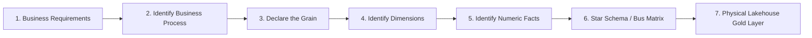

# Enterprise Data Modeling Masterclass & Reference Architecture

> **"If your business process is wrong, your grain is wrong. If your grain is wrong, your facts are wrong. If your facts are wrong, your entire data warehouse is a lie."**

---

## 🏛️ Executive Architecture Overview

This repository serves as a definitive, production-grade guide to **Enterprise Dimensional Data Modeling** for modern data warehouses and lakehouses (Snowflake, Databricks Unity Catalog, Google BigQuery, Microsoft Fabric).

Rather than abstract definitions, this repository approaches data modeling through two comprehensive, enterprise-scale case studies:
1. **[GlobalMart 78-Part Deep-Dive (`big example.md`)](./big%20example.md)** — A multinational retail & e-commerce conglomerate spanning 50+ countries, 20,000+ stores, 100M+ customers, and billions of rows.
2. **[FlashCart Quick-Commerce Study (`FLASHCART_CASE_STUDY.md`)](./FLASHCART_CASE_STUDY.md)** — A hyper-growth, on-demand delivery ecosystem operating across orders, micro-fulfillment centers, couriers, real-time inventory, and dispatch logistics.

---

## 🎯 The Core Philosophy: The Senior Architect Mindset

When high-level data engineers and data architects design an enterprise analytical model, they follow a disciplined mental model:

### Golden Rules of Dimensional Modeling
1. **Never Model from Questions Alone:** Questions change daily; underlying business processes generate events consistently for years.
2. **One Business Process = One Fact Family:** Never cram Sales, Payments, and Logistics Deliveries into a single monolithic fact table.
3. **Respect Grain Invariance:** Every dimension key and every measurement in a fact table must exist at the exact declared grain of the row.
4. **Conformed Dimensions are Non-Negotiable:** If `DimCustomer` or `DimProduct` means different things across departments, enterprise cross-process analytics is impossible.
5. **Surrogate Keys Rule the Warehouse:** Never use operational natural keys directly as foreign keys in fact tables.