Yes. Let's do **one giant enterprise case study** and use it to teach the whole thing from requirements → business processes → grain → facts → dimensions → multiple stars → SCD → snapshots → factless facts → bridges → conformed dimensions → Gold layer → physical design → data quality → performance.

I’ll deliberately make it complex enough that you have to **think like a Data Engineer/warehouse architect**, not memorize textbook definitions.

Current Microsoft guidance still treats star schema, fact/dimension separation, consistent grain, surrogate keys, role-playing dimensions, SCDs, and multiple fact tables as core dimensional-modeling practices. Databricks’ current 2026 guidance also places dimensional fact/dimension models naturally in the Gold layer of a medallion/lakehouse architecture. ([Microsoft Learn][1])

# MASTER CASE STUDY: GLOBALMART

Imagine a company:

# **GlobalMart**

A multinational e-commerce + physical retail company.

It has:

```text
50+ countries
20,000+ stores
500+ distribution centers
100M+ customers
10M+ products
billions of sales lines
millions of payment attempts
millions of deliveries
millions of returns
billions of inventory observations
```

It sells through:

```text
Website
Mobile App
Physical Stores
Marketplace Partners
```

It operates:

```text
Customer Service
Warehouses
Stores
Delivery Fleet
Suppliers
Promotions
Loyalty Program
```

And now management comes to you.

---


# PART 1 — THE BUSINESS REQUIREMENTS

This is the most important starting point.

The business gives you this requirement document.

## Sales team

They want:

```text
Revenue by:
- country
- region
- store
- product
- category
- customer
- sales channel
- promotion
- day
- month
- quarter
- year

They also need:
- quantity sold
- gross sales
- discount
- tax
- net sales
- cost
- profit
```

---

## Finance team

They want:

```text
Payment attempts
Successful payments
Failed payments
Payment failure reasons
Payment methods
Payment providers
Fees
Collected amount
Refunds
```

---

## Logistics team

They want:

```text
Order fulfillment time
Packing time
Shipping time
Delivery time
Late deliveries
Courier performance
Distance
Delivery cost
```

---

## Inventory team

They want:

```text
Daily inventory by product and location
Opening stock
Closing stock
Received stock
Sold stock
Returned stock
Damaged stock
Out-of-stock periods
Inventory value
```

---

## Procurement team

They want:

```text
Purchase orders
Supplier performance
Ordered quantity
Received quantity
Rejected quantity
Purchase cost
Lead time
```

---

## Returns team

They want:

```text
Products returned
Return reasons
Refund amount
Return rate
Return by customer
Return by store
Return by product
```

---

## Marketing

They want:

```text
Campaign performance
Promotion usage
Discount
Revenue generated
Customer acquisition
Customer retention
Customer lifetime value
```

---

## Customer support

They want:

```text
Support tickets
Issue category
Resolution time
Customer
Product
Order
Agent
Satisfaction
```

---

## Executive dashboard

CEO wants:

```text
Revenue
Profit
Orders
Customers
Inventory
Returns
Delivery performance
Payment success
Marketing performance
```

Now stop.

**We have not created a single table yet.**

And that's intentional.

---


### Departmental Analytical Architecture & Requirements Flowchart

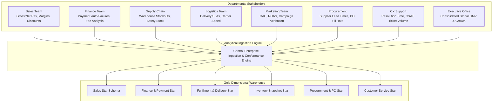
> **Key Architecture Takeaway**: Notice that each departmental requirement reflects a distinct business process with differing event triggers and natural grains. Attempting to force all these requirements into one table creates grain confusion and data corruption.


# PART 2 — YOUR FIRST JOB IS NOT TABLE DESIGN

Your first job is:

# Identify the BUSINESS PROCESSES.

From the requirements:

```text
Sales
Payments
Fulfillment
Delivery
Inventory
Procurement
Returns
Marketing
Customer Support
Customer Activity
```

Now we've moved from:

```text
business questions
```

to:

```text
business processes
```

That's the first big architectural step.

Kimball's current dimensional-modeling guidance still starts with the business process because the selected process becomes the design target from which grain, dimensions, and facts are defined. ([Kimball Group][2])

---


# PART 3 — WHY BUSINESS PROCESS COMES FIRST

Suppose management says:

> "Show revenue by country."

You don't create:

```text
FactRevenueByCountry
```

Why?

Because that's a **question**, not necessarily a business process.

Revenue was generated by some process.

Probably:

```text
Sales
```

Then you identify:

```text
Sales → Order → Order Line
```

Then determine the grain.

So:

```text
Question
 ↓
Business process
 ↓
Event/state
 ↓
Grain
 ↓
Fact
```

This is the chain I want you to remember.

---


# PART 4 — BUILD A BUS MATRIX

Now let's make an enterprise bus matrix.

| Business process | Customer | Product | Store | Date | Promotion | Supplier | Courier | Payment Method |
| ---------------- | -------- | ------- | ----- | ---- | --------- | -------- | ------- | -------------- |
| Sales            | ✓        | ✓       | ✓     | ✓    | ✓         | —        | —       | —              |
| Payment          | ✓        | —       | ✓     | ✓    | —         | —        | —       | ✓              |
| Fulfillment      | ✓        | —       | ✓     | ✓    | —         | —        | ✓       | —              |
| Delivery         | ✓        | —       | ✓     | ✓    | —         | —        | ✓       | —              |
| Inventory        | —        | ✓       | ✓     | ✓    | —         | —        | —       | —              |
| Procurement      | —        | ✓       | ✓     | ✓    | —         | ✓        | —       | —              |
| Returns          | ✓        | ✓       | ✓     | ✓    | —         | —        | —       | —              |
| Support          | ✓        | ✓       | ✓     | ✓    | —         | —        | —       | —              |

This matrix answers a major question:

> **Which dimensions should be shared between different fact tables?**

For example:

```text
DimCustomer
DimProduct
DimStore
DimDate
```

may become **conformed dimensions**.

Kimball's enterprise bus matrix specifically uses business processes as rows and dimensions as columns to identify shared/conformed dimensions. ([Kimball Group][3])

---


### Enterprise Data Warehouse Bus Matrix Visual Relationship Map

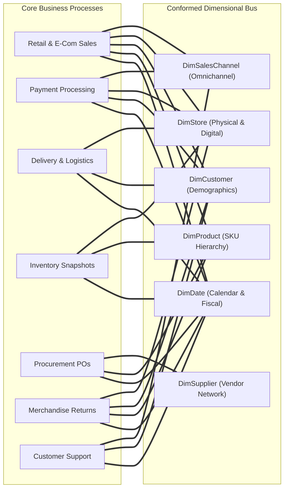
> **Bus Matrix Rule**: The rows represent business processes; the columns represent conformed dimensions. An intersection signifies that the dimensional context is natively valid at that process grain.


# PART 5 — NOW DESIGN ONE PROCESS AT A TIME

Let's start with:

# SALES

Business requirement:

> "We need product-level revenue analysis by customer, product, store, channel, promotion and time."

Now think.

---

## Step 1 — Business process

```text
Sales
```

## Step 2 — What happened?

```text
A product was sold.
```

## Step 3 — What level of detail?

The business wants:

```text
product-level
```

So ask:

> What should one row represent?

Our decision:

# ONE ROW = ONE PRODUCT LINE IN ONE ORDER

That's our grain.

This is the critical decision.

Microsoft currently emphasizes that the fact-table grain should be explicitly defined and consistently maintained; its current guidance also notes that storing data at too high a grain can make later detailed analysis impossible. ([Microsoft Learn][1])

---


# PART 6 — BUILD FACTSALES

```text
FactSales
────────────────────────────────────
sales_key
order_id
order_line_number

customer_key
product_key
store_key
date_key
channel_key
promotion_key

quantity
unit_price
gross_amount
discount_amount
tax_amount
net_amount
cost_amount
profit_amount
```

Notice the structure.

### Keys

```text
customer_key
product_key
store_key
date_key
channel_key
promotion_key
```

These connect the fact to dimensions.

### Measures

```text
quantity
unit_price
gross_amount
discount_amount
tax_amount
net_amount
cost_amount
profit_amount
```

### Business identifiers

```text
order_id
order_line_number
```

These can remain as degenerate/business identifiers in the fact.

---


### FactSales Atomic Grain Resolution Flowchart

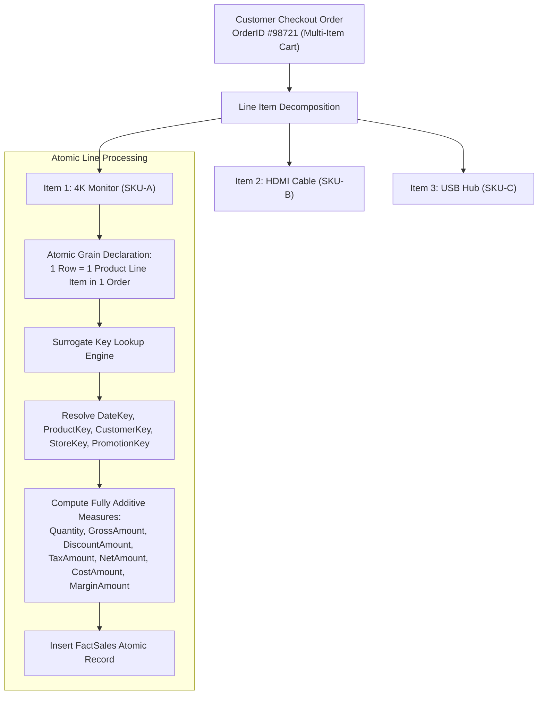
> **Fact Table Grain Rule**: Never store order-level summary totals in an order-line fact table without allocating them, because doing so creates aggregation errors when summing across dimensions.


# PART 7 — WHY DID WE NOT PUT PRODUCT NAME IN FACTSALES?

Bad design:

```text
FactSales
─────────────────────────
order_id
product_id
product_name
brand
category
customer_name
country
store_name
city
amount
```

You are repeating descriptive information billions of times.

Instead:

```text
FactSales
    |
product_key
    ↓
DimProduct
```

And:

```text
FactSales
    |
customer_key
    ↓
DimCustomer
```

The fact represents **the event**.

Dimensions describe the event.

Current Microsoft guidance explicitly defines dimensions as descriptive entities and facts as event/measurement tables used in analytical aggregation. ([Microsoft Learn][4])

---


# PART 8 — DESIGN THE DIMENSIONS

## DimCustomer

```text
DimCustomer
────────────────────────────────
customer_key
customer_id
customer_name
customer_segment
gender
date_of_birth
country
state
city
postal_code
signup_date
acquisition_channel
loyalty_tier
```

Questions this answers:

```text
Who purchased?
Which segment?
Which country?
Which city?
Which loyalty tier?
```

---

## DimProduct

```text
DimProduct
────────────────────────────────
product_key
product_id
product_name
brand
category
subcategory
department
product_type
unit
size
color
supplier_category
```

Questions:

```text
What was sold?
Which category?
Which brand?
Which department?
```

---

## DimStore

```text
DimStore
────────────────────────────────
store_key
store_id
store_name
store_type
city
state
country
region
store_format
opening_date
```

---

## DimDate

```text
DimDate
────────────────────────────────
date_key
full_date
day
week
month
month_name
quarter
year
day_of_week
is_weekend
is_holiday
fiscal_month
fiscal_quarter
fiscal_year
```

---

## DimChannel

```text
DimChannel
────────────────────────
channel_key
channel_code
channel_name
channel_type
device_type
```

---

## DimPromotion

```text
DimPromotion
────────────────────────────────
promotion_key
promotion_id
promotion_name
campaign_name
promotion_type
discount_type
campaign_start_date
campaign_end_date
```

---


### Dimension Attribute Hierarchies & Normalization Mapping

```mermaid
graph TD
    subgraph Product Dimension Hierarchy
        SKU["SKU Level (Lowest Grain)"] --> SUBCAT["Sub-Category (e.g., Wireless Mice)"]
        SUBCAT --> CAT["Category (e.g., Computer Accessories)"]
        CAT --> DEPT["Department (e.g., Electronics)"]
    end

    subgraph Store Geography Hierarchy
        STORE["Store ID (Retail Location / DC)"] --> CITY["City (e.g., Seattle)"]
        CITY --> STATE["State / Province (e.g., WA)"]
        STATE --> REGION["Territory / Region (e.g., Pacific NW)"]
        REGION --> CTRY["Country (e.g., United States)"]
    end

    subgraph Calendar Dimension Hierarchy
        DAY["Date / Day (YYYY-MM-DD)"] --> MONTH["Fiscal / Calendar Month"]
        MONTH --> QTR["Fiscal Quarter (Q1-Q4)"]
        QTR --> YEAR["Calendar Year (YYYY)"]
    end
```
> **Dimensional Design Principle**: In dimensional modeling, attribute hierarchies are deliberately denormalized into wide dimension tables to eliminate multi-table joins and optimize BI self-service query performance.


# PART 9 — OUR SALES STAR

```text
                         DimCustomer
                              |
                              |
DimProduct ------------- FactSales ------------- DimDate
                              |
                              |
                          DimStore
                              |
                              |
                         DimChannel
                              |
                              |
                        DimPromotion
```

That is one star.

But GlobalMart needs much more.

---


### GlobalMart Sales Star Schema Architectural Diagram

```mermaid
graph TD
    FS["FactSales<br/>(Atomic Line-Item Grain)"]

    D1["DimDate<br/>DateKey (PK)"]
    D2["DimProduct<br/>ProductKey (PK)"]
    D3["DimCustomer<br/>CustomerKey (PK)"]
    D4["DimStore<br/>StoreKey (PK)"]
    D5["DimPromotion<br/>PromotionKey (PK)"]
    D6["DimSalesChannel<br/>SalesChannelKey (PK)"]

    FS -->|DateKey (FK)| D1
    FS -->|ProductKey (FK)| D2
    FS -->|CustomerKey (FK)| D3
    FS -->|StoreKey (FK)| D4
    FS -->|PromotionKey (FK)| D5
    FS -->|SalesChannelKey (FK)| D6
```
> **The Classic Star**: All dimension tables have direct, single-hop 1:N relationships to the central FactSales table. This is the optimal physical and semantic model for business intelligence engines.


# PART 10 — THE PAYMENT PROCESS

Requirement:

> "Finance needs every payment attempt, including failures."

Think:

```text
Business process
→ Payment
```

What happened?

```text
A payment attempt occurred.
```

What is the grain?

# ONE ROW = ONE PAYMENT ATTEMPT

Now create:

```text
FactPayment
────────────────────────────────
payment_key
payment_id
order_id

customer_key
store_key
date_key
payment_method_key
payment_provider_key

attempt_number
payment_status
failure_reason
payment_amount
processing_fee
```

Dimensions:

```text
DimCustomer
DimStore
DimDate
DimPaymentMethod
DimPaymentProvider
```

---


### Payment Processing State Machine & Attempt Cardinality

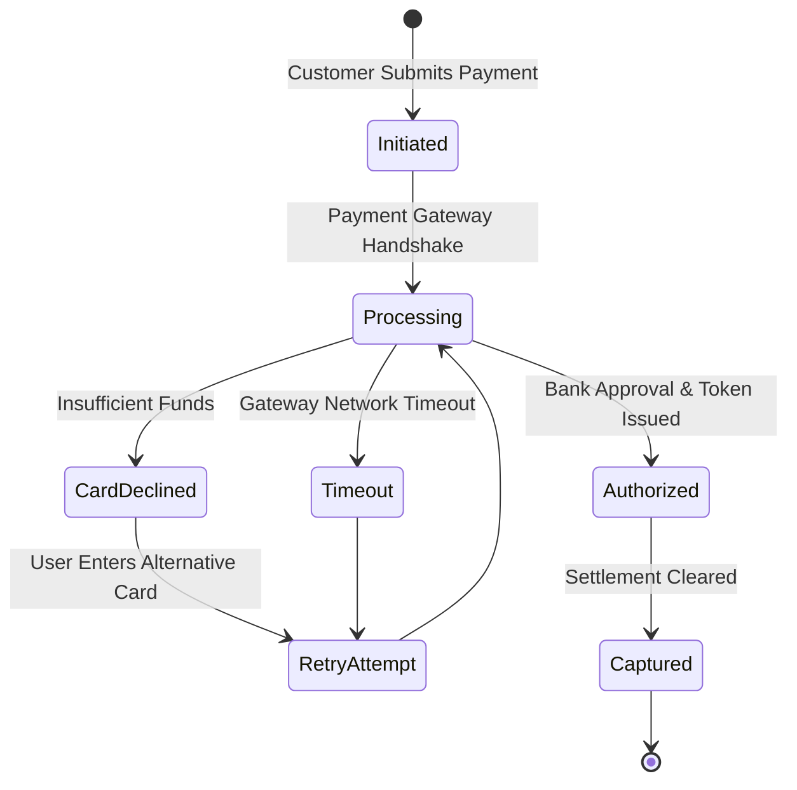
> **Why Payment Must Be Separate**: An order may experience three payment failures before a successful capture occurs. If payment were merged into sales lines, tracking failure rates or payment attempt latencies would corrupt sales grain.


# PART 11 — WHY PAYMENT DOES NOT BELONG IN FACTSALES

This is where you're supposed to think.

Suppose one order contains:

```text
many order lines
```

and has:

```text
many payment attempts
```

Those are different grains.

If you combine:

```text
order line
+
payment attempt
```

you risk multiplication.

Therefore:

```text
FactSales
```

and:

```text
FactPayment
```

are separate.

### Key rule

> **Different grain → separate fact.**

Not always, but as a design warning, this is one of your strongest rules.

---


# PART 12 — DELIVERY PROCESS

Requirement:

> "Measure delivery time, distance, lateness and courier performance."

Business process:

```text
Delivery
```

What happened?

```text
A delivery occurred.
```

Grain:

# ONE ROW = ONE DELIVERY

Fact:

```text
FactDelivery
────────────────────────────────
delivery_key
order_id

customer_key
store_key
courier_key

pickup_date_key
delivery_date_key

delivery_status
promised_minutes
actual_minutes
late_minutes
distance_km
delivery_fee
delivery_cost
```

Dimensions:

```text
DimCustomer
DimStore
DimCourier
DimDate
```

Now:

```text
pickup_date_key
delivery_date_key
```

Both connect to the same physical:

```text
DimDate
```

This is a:

# ROLE-PLAYING DIMENSION

Current Microsoft guidance explicitly calls out this pattern: the same physical dimension can be referenced multiple times in a fact for different roles, such as order date and ship date. ([Microsoft Learn][1])

---


### Multi-Date Role-Playing Dimension Architecture

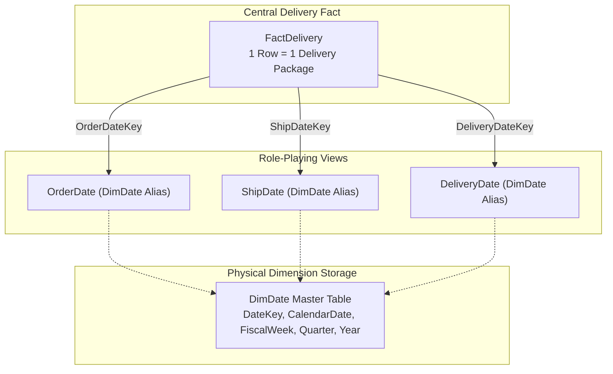
> **Role-Playing Mechanism**: The physical `DimDate` table exists only once in the database, but is referenced multiple times with distinct semantic aliases to represent the different dates in a delivery lifecycle.


# PART 13 — DELIVERY STAR

```text
                         DimCustomer
                              |
                              |
DimStore ---------------- FactDelivery ---------------- DimCourier
                              |
                              |
                           DimDate
                         /        \
                        /          \
               pickup date     delivery date
```

Same date dimension.

Two roles.

---


# PART 14 — INVENTORY

Now your thinking gets more advanced.

Requirement:

> "Every day, we need product inventory at every store."

Ask:

### Is inventory an event or state?

Mostly:

```text
STATE
```

### What does one row represent?

# ONE ROW = ONE PRODUCT + ONE STORE + ONE DAY

This is not the same as sales.

Fact:

```text
FactInventorySnapshot
────────────────────────────────
date_key
product_key
store_key

opening_quantity
received_quantity
sold_quantity
returned_quantity
damaged_quantity
closing_quantity
inventory_value
out_of_stock_flag
```

Fact type:

# PERIODIC SNAPSHOT

---


### Periodic Snapshot vs Event Transaction Flowchart

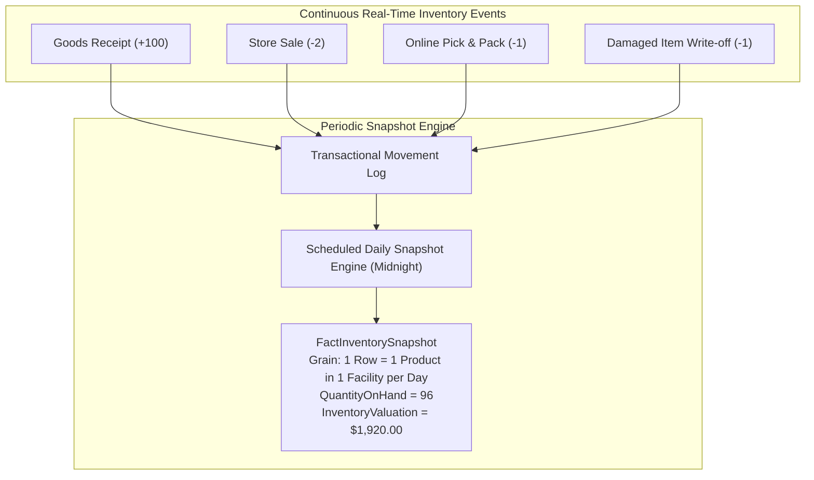
> **Periodic Snapshot Value**: Without snapshotting, calculating inventory value on October 1st from five years of raw transactions requires summing millions of historical deltas. A periodic snapshot enables instantaneous point-in-time state queries.


# PART 15 — WHY SNAPSHOT?

Because we're capturing:

> "What was the inventory state at the end of each day?"

We aren't recording just one event.

We are recording a state repeatedly.

So:

```text
Sales
→ transaction fact

Inventory
→ periodic snapshot fact
```

Microsoft's current fact guidance recognizes transaction, periodic snapshot, and accumulating snapshot facts as the primary fact types. ([Microsoft Learn][1])

---


# PART 16 — PROCUREMENT

Requirement:

> "Analyze supplier orders, received quantities, rejected quantities and cost."

Business process:

```text
Procurement / Purchase Order
```

What happened?

```text
A purchase order line was created.
```

Grain:

# ONE ROW = ONE PRODUCT LINE IN ONE PURCHASE ORDER

Fact:

```text
FactPurchaseOrder
────────────────────────────────
purchase_order_key
purchase_order_id
purchase_order_line_number

supplier_key
product_key
warehouse_key
order_date_key
expected_date_key

ordered_quantity
unit_cost
ordered_amount
```

Dimensions:

```text
DimSupplier
DimProduct
DimWarehouse
DimDate
```

This is another star.

---


# PART 17 — BUT PROCUREMENT DOESN'T END AT ORDERING

Business also wants:

> "How much did suppliers actually deliver?"

Now ask:

Is "ordered" the same process as "received"?

They may be related but not necessarily the same business event.

You might need:

```text
FactGoodsReceipt
```

with grain:

# ONE ROW = ONE PRODUCT LINE RECEIVED IN ONE GOODS-RECEIPT EVENT

Structure:

```text
FactGoodsReceipt
────────────────────────────────
goods_receipt_key
purchase_order_id
receipt_id

supplier_key
product_key
warehouse_key
receipt_date_key

received_quantity
accepted_quantity
rejected_quantity
purchase_cost
```

Notice the difference:

```text
FactPurchaseOrder
→ what we ordered

FactGoodsReceipt
→ what we actually received
```

Different events.

---


### Procure-to-Pay (P2P) Pipeline & 3-Way Matching Flowchart

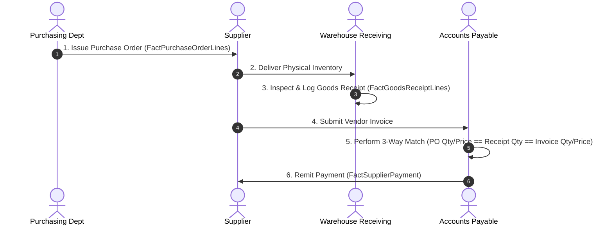
> **P2P Modeling Principle**: Because PO creation, physical receiving, and invoice disbursement occur weeks apart and at different grains, enterprise procurement is modeled as a pipeline of coordinating fact tables or an accumulating snapshot.


# PART 18 — RETURNS

Requirement:

> "Analyze returned order items and refund amounts."

Business process:

```text
Returns
```

Grain:

# ONE ROW = ONE RETURNED ORDER LINE

Fact:

```text
FactReturn
────────────────────────────────
return_key
return_id
order_id
order_line_number

customer_key
product_key
store_key
return_date_key
return_reason_key

quantity_returned
refund_amount
restocking_fee
```

Dimensions:

```text
DimCustomer
DimProduct
DimStore
DimDate
DimReturnReason
```

Again:

```text
new process
+
new grain
=
new fact
```

---


# PART 19 — CUSTOMER SUPPORT

Requirement:

> "Analyze support cases, issue types, resolution time and satisfaction."

Business process:

```text
Support Ticket
```

Grain:

# ONE ROW = ONE SUPPORT TICKET

Fact:

```text
FactSupportTicket
────────────────────────────────
ticket_key
ticket_id
order_id

customer_key
product_key
store_key
agent_key
date_key
issue_key

opened_timestamp
resolved_timestamp
resolution_minutes
satisfaction_score
reopen_count
```

Dimensions:

```text
DimCustomer
DimProduct
DimStore
DimAgent
DimDate
DimIssue
```

---


# PART 20 — CUSTOMER ACTIVITY

Marketing says:

> "We want daily active customer behavior."

Now think carefully.

Maybe:

# ONE ROW = ONE CUSTOMER + ONE DAY

Fact:

```text
FactCustomerDailyActivity
────────────────────────────────
date_key
customer_key

sessions
orders
items_purchased
revenue
returns
support_tickets
is_active
```

This is a derived analytical fact.

It's not an independent raw business event in the same way a sale is.

It could be useful as an **aggregate/behavioral fact**.

The point is:

> **Not every fact has to directly mirror one source transaction table.**

You can create derived facts if the business need justifies them.

---


# PART 21 — MARKETING PERFORMANCE

Now here's where I want you to think before creating anything.

Marketing says:

> "Show revenue from each promotion."

Do we need:

```text
FactPromotionPerformance
```

Not necessarily.

Why?

Because `FactSales` already contains:

```text
promotion_key
net_amount
discount_amount
```

So we can calculate:

```text
Revenue by Promotion
Discount by Promotion
Orders by Promotion
```

using:

```text
FactSales
+
DimPromotion
```

### IMPORTANT

> **A new business question does not automatically require a new fact table.**

This single idea will save you from creating dozens of unnecessary tables.

---


# PART 22 — NOW LOOK AT THE FACTS

We have:

```text
FactSales
FactPayment
FactDelivery
FactInventorySnapshot
FactPurchaseOrder
FactGoodsReceipt
FactReturn
FactSupportTicket
FactCustomerDailyActivity
```

This is a **fact constellation / enterprise dimensional model** with multiple stars.

Current Microsoft guidance explicitly states that a star schema often contains multiple fact tables, and therefore multiple stars. ([Microsoft Learn][5])

---


# PART 23 — SHARED DIMENSIONS

Look at this:

```text
FactSales
   ↓
DimCustomer

FactPayment
   ↓
DimCustomer

FactReturn
   ↓
DimCustomer

FactSupportTicket
   ↓
DimCustomer
```

Same customer concept.

So:

```text
DimCustomer
```

can be conformed.

Same with:

```text
DimProduct
DimStore
DimDate
```

These become shared dimensions.

---


# PART 24 — WHAT DOES "CONFORMED" REALLY MEAN?

It means the dimension has a **consistent business meaning and definition across fact tables**.

Imagine:

```text
DimProduct
```

is used by:

```text
FactSales
FactReturn
FactInventory
FactPurchase
```

Then everybody uses the same:

```text
product_id
brand
category
subcategory
department
```

You avoid:

```text
SalesCategory
InventoryCategory
ReturnsCategory
```

with conflicting definitions.

Microsoft's current guidance specifically identifies conformed dimensions as dimensions shared across multiple fact tables/stars for consistency and reduced maintenance. ([Microsoft Learn][6])

---


### Conformed Dimensions Cross-Process Drill-Across Flowchart

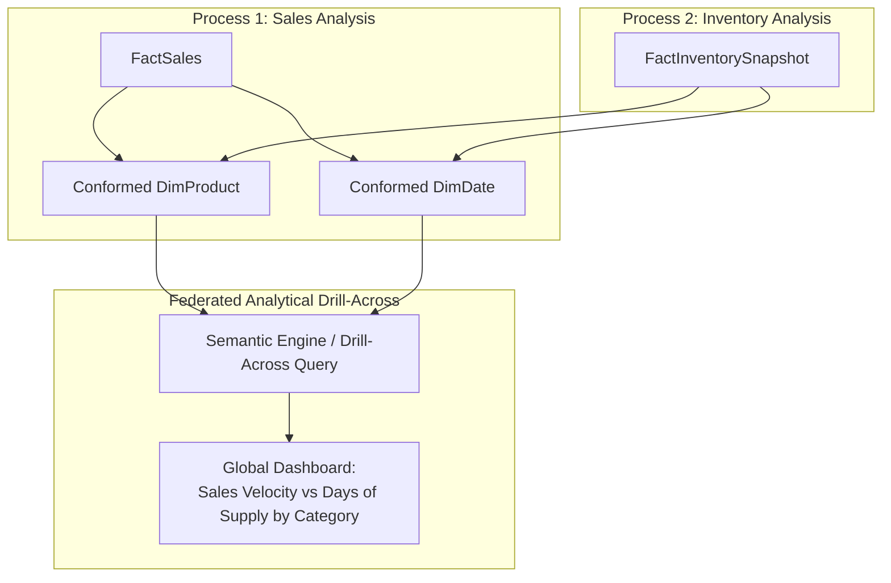
> **Drill-Across Rule**: You never perform a raw SQL JOIN directly between FactSales and FactInventory. Instead, query each fact independently grouped by the conformed dimension attributes, and stitch the two results together in the semantic layer.


# PART 25 — THE ENTERPRISE MODEL

At a high level:

```text
                         ┌────────────────┐
                         │ DimCustomer    │
                         └───────┬────────┘
                                 │
          ┌──────────────────────┼───────────────────────┐
          │                      │                       │
          ▼                      ▼                       ▼
      FactSales             FactPayment             FactReturn
          │                      │                       │
          │                      │                       │
     DimProduct          DimPaymentMethod        DimReturnReason
          │
          │
     DimStore
          │
          │
        DimDate
          │
      ┌───┼────────────────────┐
      │   │                    │
      ▼   ▼                    ▼
FactDelivery          FactInventorySnapshot   FactPurchaseOrder
   │                         │                    │
DimCourier               DimProduct          DimSupplier
                          DimStore            DimWarehouse
                          DimDate             DimDate
```

This isn't necessarily physically one diagram in the database.

It's the **logical analytical architecture**.

---


### GlobalMart Enterprise Constellation (Multi-Star) Architecture

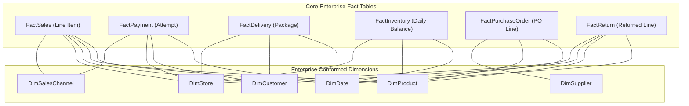
> **Enterprise Constellation**: The enterprise data warehouse is not a single giant star schema; it is a constellation of multiple stars bound together by shared, conformed dimensions.


# PART 26 — NOW ASK: WHY DO WE NEED DIMENSION KEYS?

Suppose `DimCustomer` contains:

```text
customer_key
customer_id
customer_name
country
segment
```

FactSales uses:

```text
customer_key
```

Why not just:

```text
customer_id
```

Because the warehouse may need to distinguish historical versions.

This leads us to:

# SURROGATE KEYS

---


# PART 27 — SCD TYPE 2

Suppose a customer's segment changes.

Business says:

> "We need historical reporting."

You cannot simply overwrite:

```text
Silver → Gold
```

because then old sales would appear to have been made when the customer was Gold.

Instead create dimension versions.

Conceptually:

```text
DimCustomer
──────────────────────────────────────
customer_key
customer_id
customer_name
segment
country
effective_from
effective_to
is_current
```

Now:

```text
customer_id
   ↓
same business customer
   ↓
multiple dimension versions
```

Facts point to the correct surrogate version.

---


### SCD Type 2 Historical Record Versioning Timeline

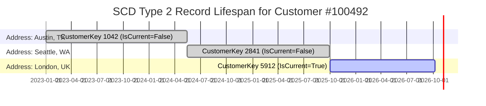
> **Surrogate Key Invariance**: Sales made to customer #100492 in 2023 permanently point to `CustomerKey 1042`, preserving historical reporting for Texas sales tax, even when the customer later relocates to London.


# PART 28 — WHY THIS MATTERS

Suppose a sale happened while customer was:

```text
Silver
```

Later:

```text
Silver → Gold
```

Historical analysis should answer:

> What was the customer classified as when the sale happened?

If you overwrote the dimension:

```text
Gold
```

you've lost the historical state.

SCD2 preserves it.

Databricks' current 2026 dimensional-modeling guidance explicitly supports SCD Type 2 in Gold-layer dimensions when historical versions are required. ([Databricks Documentation][7])

---


# PART 29 — BUT DON'T MAKE EVERY DIMENSION SCD2

This is another senior-level judgment.

Suppose:

```text
customer_name
```

contains a typo.

You probably don't need:

```text
Version 1 = Rohn
Version 2 = Rohan
```

for every typo.

You may use:

```text
SCD Type 1
```

for corrections.

But:

```text
customer_segment
sales_region
loyalty_tier
```

might require historical tracking.

Therefore:

> **History strategy is driven by business meaning.**

Not:

> "All dimensions = SCD2."

---


# PART 30 — ROLE-PLAYING DIMENSIONS

Consider:

```text
FactDelivery
```

It has:

```text
pickup_date_key
delivery_date_key
```

Both use:

```text
DimDate
```

One dimension.

Two roles.

```text
                DimDate
               /       \
              /         \
       Pickup Date   Delivery Date
               \         /
                \       /
               FactDelivery
```

Another example:

```text
FactPurchaseOrder
```

might have:

```text
order_date_key
expected_date_key
receipt_date_key
```

Again, same date dimension in different roles.

---


### Date Dimension Role-Playing in Enterprise Semantic Models

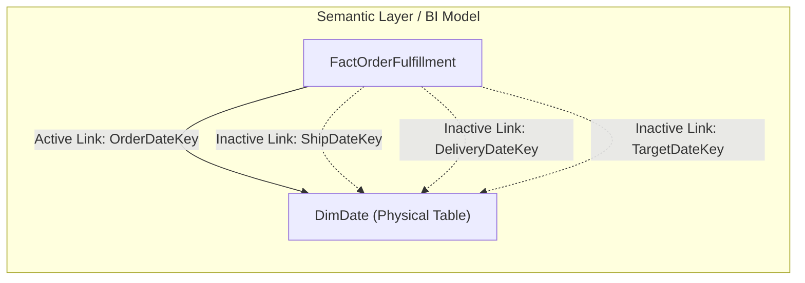
> **Semantic Implementation**: Modern BI engines like Microsoft Power BI and Fabric utilize active vs. inactive relationships or DAX `USERELATIONSHIP()` expressions to navigate role-playing dates without duplicating tables in storage.


# PART 31 — DEGNERATE DIMENSION

In FactSales:

```text
order_id
```

might not justify its own dimension.

But analysts may need to filter by:

```text
order_id
```

So keep it directly in the fact.

That's a:

# DEGENERATE DIMENSION

The important mental model:

> **A business identifier useful for analysis can remain in the fact without becoming a separate dimension.**

---


# PART 32 — JUNK DIMENSION

Suppose sales has many small flags:

```text
is_gift
is_first_order
is_coupon_used
is_marketplace
is_express
is_priority
```

You don't necessarily need a separate dimension for every tiny attribute.

Combine them:

```text
DimOrderFlags
────────────────────────
flag_key
is_gift
is_first_order
is_coupon_used
is_marketplace
is_express
is_priority
```

That's a:

# JUNK DIMENSION

Microsoft's current star-schema guidance still lists junk dimensions among the established dimensional-modeling techniques. ([Microsoft Learn][8])

---


# PART 33 — BRIDGE TABLES / MANY-TO-MANY

Here's an advanced problem.

Suppose:

> One promotion can involve multiple products.

And:

> One product can belong to multiple promotions.

That's:

```text
Product M : M Promotion
```

You don't simply join them directly.

You may need a bridge:

```text
BridgeProductPromotion
────────────────────────
product_key
promotion_key
effective_from
effective_to
```

Now:

```text
DimProduct
     |
     |
BridgeProductPromotion
     |
     |
DimPromotion
```

This is useful when the relationship itself matters.

---


### Bridge Table Architecture for Many-to-Many Relationships

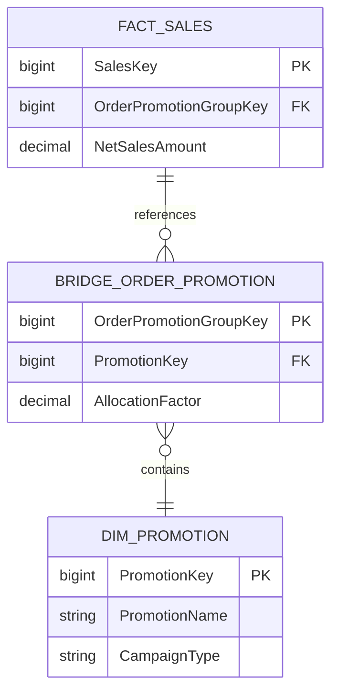
> **Weighting Factors in Bridge Tables**: When multiple promotions apply to a single transaction, the bridge table contains an `AllocationFactor` (e.g., 0.50 and 0.50) so that aggregating promotion discounts across categories does not multiply sales totals.


# PART 34 — ANOTHER MANY-TO-MANY EXAMPLE

Suppose a product can have multiple suppliers.

And a supplier can supply multiple products.

```text
Product M : M Supplier
```

Bridge:

```text
BridgeProductSupplier
────────────────────────
product_key
supplier_key
supplier_priority
effective_from
effective_to
```

Now you can answer:

> Which supplier supplied this product at a given time?

This is an example of how **business relationships** can require additional modeling structures.

---


# PART 35 — FACTLESS FACT

Suppose GlobalMart launches a campaign:

> "Which customers were eligible for which promotion?"

There may not be a numeric measure.

You could have:

```text
FactPromotionEligibility
────────────────────────────
customer_key
promotion_key
date_key
channel_key
```

The row itself represents an event/relationship:

```text
customer was eligible for promotion
```

You can count rows.

That's a **factless fact**.

Current Microsoft guidance explicitly includes factless facts as valid fact tables. ([Microsoft Learn][1])

---


# PART 36 — ACCUMULATING SNAPSHOT

Now consider order fulfillment.

Requirement:

> Track the lifecycle:

```text
Order Created
↓
Packed
↓
Shipped
↓
Delivered
```

This is not simply a sale.

You may design:

```text
FactOrderFulfillment
────────────────────────────────
order_key
customer_key
store_key
courier_key

created_date_key
packed_date_key
shipped_date_key
delivered_date_key

created_to_pack_minutes
pack_to_ship_minutes
ship_to_delivery_minutes
total_cycle_minutes
late_flag
```

Grain:

# ONE ROW = ONE ORDER FULFILLMENT LIFECYCLE

This is:

# ACCUMULATING SNAPSHOT

Because the row gets updated as the process passes through milestones.

---


### Accumulating Snapshot Order Lifecycle Milestone Flowchart

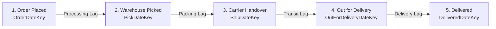
> **Accumulating Snapshot Purpose**: An accumulating snapshot record is updated as the order advances through predefined milestones. This allows direct calculation of end-to-end cycle times and identifying fulfillment bottlenecks.


# PART 37 — PERIODIC VS ACCUMULATING

Think:

### Inventory

```text
"What was the state every day?"
```

→ Periodic snapshot.

### Fulfillment

```text
"How did this order move through stages?"
```

→ Accumulating snapshot.

This distinction should become automatic.

---


# PART 38 — TRANSACTION FACT

Think:

```text
A sale happened.
A payment happened.
A return happened.
A purchase line happened.
```

These are:

# TRANSACTION FACTS

Usually the event is captured once.

Microsoft currently describes transaction facts as business events at the lowest useful granularity, generally with additive measurements where appropriate. ([Microsoft Learn][1])

---


# PART 39 — ADDITIVE VS SEMI-ADDITIVE

Now imagine:

```text
FactSales
```

has:

```text
quantity
net_amount
profit
```

These are generally additive.

You can use:

```text
SUM(net_amount)
```

across many dimensions.

But inventory:

```text
closing_quantity
```

is different.

You don't necessarily do:

```text
SUM(closing_quantity)
```

across time.

It is typically:

# SEMI-ADDITIVE

You may aggregate across:

```text
product
store
```

but not blindly across:

```text
date
```

This is why understanding measures is not merely:

> "numbers go in fact tables."

You need to understand **how those numbers can be aggregated**.

---


# PART 40 — NON-ADDITIVE

Examples:

```text
unit_price
margin_percent
conversion_rate
```

You don't generally:

```text
SUM(margin_percent)
```

Instead calculate the metric appropriately.

For example:

```text
profit / revenue
```

rather than summing individual percentages.

This is a major analytical correctness issue.

---


# PART 41 — FACT TABLE GRANULARITY

Here are GlobalMart's grains:

```text
FactSales
→ one product line in one order

FactPayment
→ one payment attempt

FactDelivery
→ one delivery

FactInventorySnapshot
→ one product + store + day

FactPurchaseOrder
→ one product line in one purchase order

FactGoodsReceipt
→ one product line received in one receipt event

FactReturn
→ one returned order line

FactSupportTicket
→ one support ticket

FactOrderFulfillment
→ one order lifecycle
```

Look at this.

Every fact has a **sentence** describing it.

That's what I want you to start doing.

---


### Granularity Rollup Hierarchy & Loss of Analytical Context

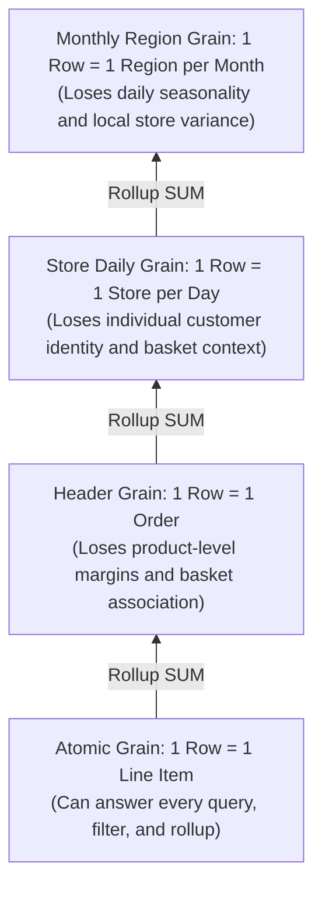
> **Atomic Grain Rule**: Always model and preserve the atomic grain in your core fact tables. You can always summarize atomic data up into any level, but you can never drill down from an aggregated table into details that were not preserved.
