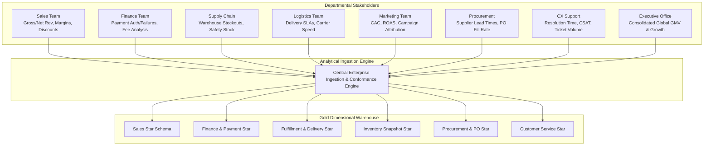

Yes. Let's do **one giant enterprise case study** and use it to teach the whole thing from requirements → business processes → grain → facts → dimensions → multiple stars → SCD → snapshots → factless facts → bridges → conformed dimensions → Gold layer → physical design → data quality → performance.

I’ll deliberately make it complex enough that you have to **think like a Data Engineer/warehouse architect**, not memorize textbook definitions.

Current Microsoft guidance still treats star schema, fact/dimension separation, consistent grain, surrogate keys, role-playing dimensions, SCDs, and multiple fact tables as core dimensional-modeling practices. Databricks’ current 2026 guidance also places dimensional fact/dimension models naturally in the Gold layer of a medallion/lakehouse architecture. ([Microsoft Learn][1])

# MASTER CASE STUDY: GLOBALMART

Imagine a company:

# **GlobalMart**

A multinational e-commerce + physical retail company.

It has:

```text
50+ countries
20,000+ stores
500+ distribution centers
100M+ customers
10M+ products
billions of sales lines
millions of payment attempts
millions of deliveries
millions of returns
billions of inventory observations
```

It sells through:

```text
Website
Mobile App
Physical Stores
Marketplace Partners
```

It operates:

```text
Customer Service
Warehouses
Stores
Delivery Fleet
Suppliers
Promotions
Loyalty Program
```

And now management comes to you.

---


# PART 1 — THE BUSINESS REQUIREMENTS

This is the most important starting point.

The business gives you this requirement document.

## Sales team

They want:

```text
Revenue by:
- country
- region
- store
- product
- category
- customer
- sales channel
- promotion
- day
- month
- quarter
- year

They also need:
- quantity sold
- gross sales
- discount
- tax
- net sales
- cost
- profit
```

---

## Finance team

They want:

```text
Payment attempts
Successful payments
Failed payments
Payment failure reasons
Payment methods
Payment providers
Fees
Collected amount
Refunds
```

---

## Logistics team

They want:

```text
Order fulfillment time
Packing time
Shipping time
Delivery time
Late deliveries
Courier performance
Distance
Delivery cost
```

---

## Inventory team

They want:

```text
Daily inventory by product and location
Opening stock
Closing stock
Received stock
Sold stock
Returned stock
Damaged stock
Out-of-stock periods
Inventory value
```

---

## Procurement team

They want:

```text
Purchase orders
Supplier performance
Ordered quantity
Received quantity
Rejected quantity
Purchase cost
Lead time
```

---

## Returns team

They want:

```text
Products returned
Return reasons
Refund amount
Return rate
Return by customer
Return by store
Return by product
```

---

## Marketing

They want:

```text
Campaign performance
Promotion usage
Discount
Revenue generated
Customer acquisition
Customer retention
Customer lifetime value
```

---

## Customer support

They want:

```text
Support tickets
Issue category
Resolution time
Customer
Product
Order
Agent
Satisfaction
```

---

## Executive dashboard

CEO wants:

```text
Revenue
Profit
Orders
Customers
Inventory
Returns
Delivery performance
Payment success
Marketing performance
```

Now stop.

**We have not created a single table yet.**

And that's intentional.

---


### Departmental Analytical Architecture & Requirements Flowchart


> **Key Architecture Takeaway**: Notice that each departmental requirement reflects a distinct business process with differing event triggers and natural grains. Attempting to force all these requirements into one table creates grain confusion and data corruption.
