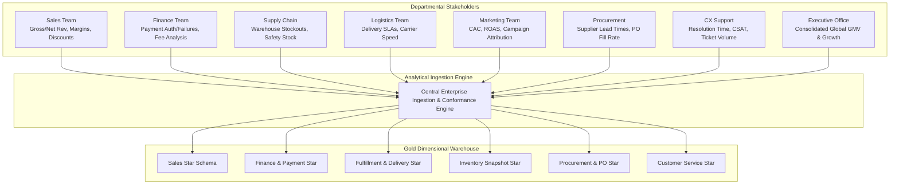
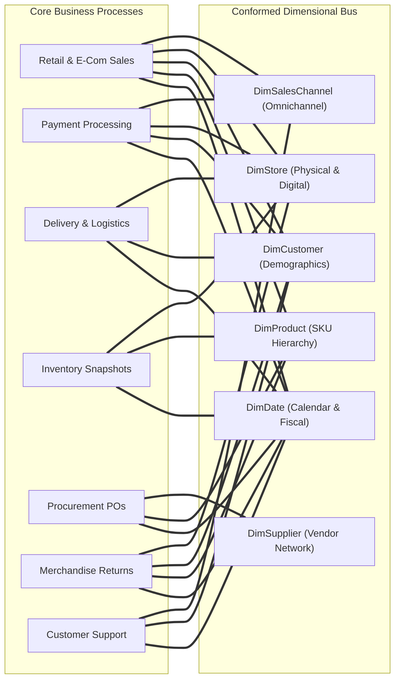
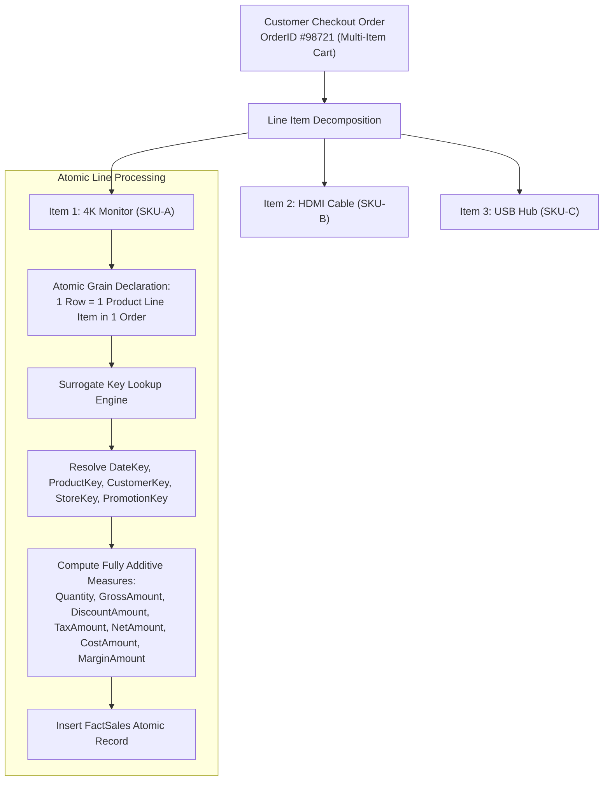
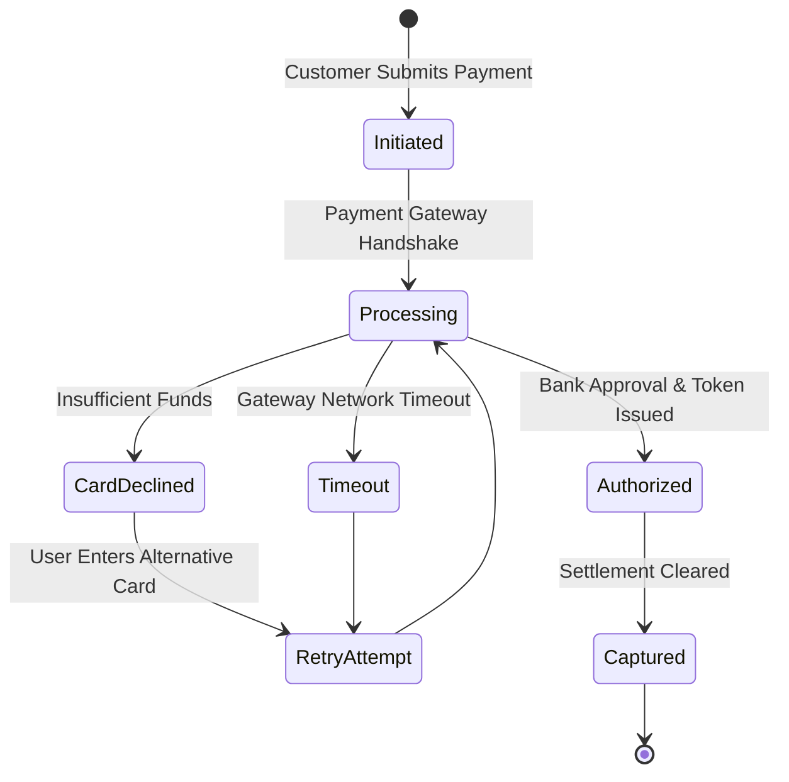
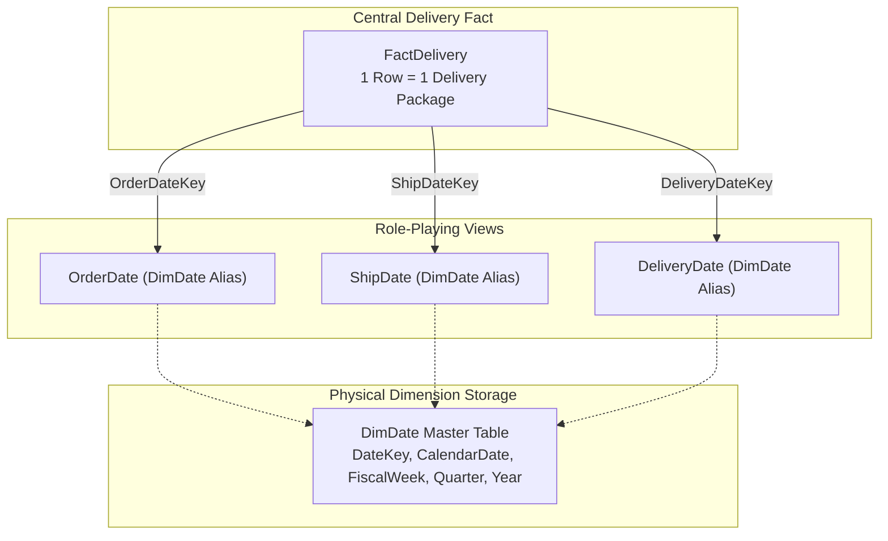
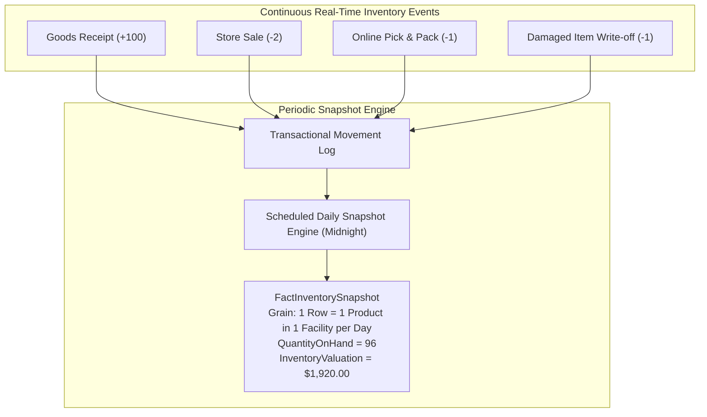
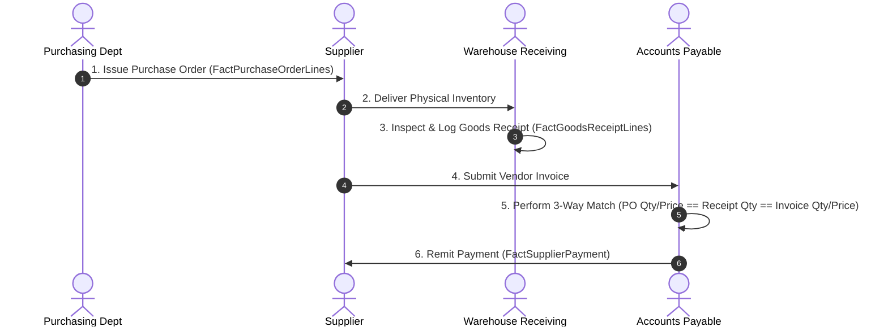

Yes. Let's do **one giant enterprise case study** and use it to teach the whole thing from requirements → business processes → grain → facts → dimensions → multiple stars → SCD → snapshots → factless facts → bridges → conformed dimensions → Gold layer → physical design → data quality → performance.

I’ll deliberately make it complex enough that you have to **think like a Data Engineer/warehouse architect**, not memorize textbook definitions.

Current Microsoft guidance still treats star schema, fact/dimension separation, consistent grain, surrogate keys, role-playing dimensions, SCDs, and multiple fact tables as core dimensional-modeling practices. Databricks’ current 2026 guidance also places dimensional fact/dimension models naturally in the Gold layer of a medallion/lakehouse architecture. ([Microsoft Learn][1])

# MASTER CASE STUDY: GLOBALMART

Imagine a company:

# **GlobalMart**

A multinational e-commerce + physical retail company.

It has:

```text
50+ countries
20,000+ stores
500+ distribution centers
100M+ customers
10M+ products
billions of sales lines
millions of payment attempts
millions of deliveries
millions of returns
billions of inventory observations
```

It sells through:

```text
Website
Mobile App
Physical Stores
Marketplace Partners
```

It operates:

```text
Customer Service
Warehouses
Stores
Delivery Fleet
Suppliers
Promotions
Loyalty Program
```

And now management comes to you.

---


# PART 1 — THE BUSINESS REQUIREMENTS

This is the most important starting point.

The business gives you this requirement document.

## Sales team

They want:

```text
Revenue by:
- country
- region
- store
- product
- category
- customer
- sales channel
- promotion
- day
- month
- quarter
- year

They also need:
- quantity sold
- gross sales
- discount
- tax
- net sales
- cost
- profit
```

---

## Finance team

They want:

```text
Payment attempts
Successful payments
Failed payments
Payment failure reasons
Payment methods
Payment providers
Fees
Collected amount
Refunds
```

---

## Logistics team

They want:

```text
Order fulfillment time
Packing time
Shipping time
Delivery time
Late deliveries
Courier performance
Distance
Delivery cost
```

---

## Inventory team

They want:

```text
Daily inventory by product and location
Opening stock
Closing stock
Received stock
Sold stock
Returned stock
Damaged stock
Out-of-stock periods
Inventory value
```

---

## Procurement team

They want:

```text
Purchase orders
Supplier performance
Ordered quantity
Received quantity
Rejected quantity
Purchase cost
Lead time
```

---

## Returns team

They want:

```text
Products returned
Return reasons
Refund amount
Return rate
Return by customer
Return by store
Return by product
```

---

## Marketing

They want:

```text
Campaign performance
Promotion usage
Discount
Revenue generated
Customer acquisition
Customer retention
Customer lifetime value
```

---

## Customer support

They want:

```text
Support tickets
Issue category
Resolution time
Customer
Product
Order
Agent
Satisfaction
```

---

## Executive dashboard

CEO wants:

```text
Revenue
Profit
Orders
Customers
Inventory
Returns
Delivery performance
Payment success
Marketing performance
```

Now stop.

**We have not created a single table yet.**

And that's intentional.

---


### Departmental Analytical Architecture & Requirements Flowchart


> **Key Architecture Takeaway**: Notice that each departmental requirement reflects a distinct business process with differing event triggers and natural grains. Attempting to force all these requirements into one table creates grain confusion and data corruption.


# PART 2 — YOUR FIRST JOB IS NOT TABLE DESIGN

Your first job is:

# Identify the BUSINESS PROCESSES.

From the requirements:

```text
Sales
Payments
Fulfillment
Delivery
Inventory
Procurement
Returns
Marketing
Customer Support
Customer Activity
```

Now we've moved from:

```text
business questions
```

to:

```text
business processes
```

That's the first big architectural step.

Kimball's current dimensional-modeling guidance still starts with the business process because the selected process becomes the design target from which grain, dimensions, and facts are defined. ([Kimball Group][2])

---


# PART 3 — WHY BUSINESS PROCESS COMES FIRST

Suppose management says:

> "Show revenue by country."

You don't create:

```text
FactRevenueByCountry
```

Why?

Because that's a **question**, not necessarily a business process.

Revenue was generated by some process.

Probably:

```text
Sales
```

Then you identify:

```text
Sales → Order → Order Line
```

Then determine the grain.

So:

```text
Question
 ↓
Business process
 ↓
Event/state
 ↓
Grain
 ↓
Fact
```

This is the chain I want you to remember.

---


# PART 4 — BUILD A BUS MATRIX

Now let's make an enterprise bus matrix.

| Business process | Customer | Product | Store | Date | Promotion | Supplier | Courier | Payment Method |
| ---------------- | -------- | ------- | ----- | ---- | --------- | -------- | ------- | -------------- |
| Sales            | ✓        | ✓       | ✓     | ✓    | ✓         | —        | —       | —              |
| Payment          | ✓        | —       | ✓     | ✓    | —         | —        | —       | ✓              |
| Fulfillment      | ✓        | —       | ✓     | ✓    | —         | —        | ✓       | —              |
| Delivery         | ✓        | —       | ✓     | ✓    | —         | —        | ✓       | —              |
| Inventory        | —        | ✓       | ✓     | ✓    | —         | —        | —       | —              |
| Procurement      | —        | ✓       | ✓     | ✓    | —         | ✓        | —       | —              |
| Returns          | ✓        | ✓       | ✓     | ✓    | —         | —        | —       | —              |
| Support          | ✓        | ✓       | ✓     | ✓    | —         | —        | —       | —              |

This matrix answers a major question:

> **Which dimensions should be shared between different fact tables?**

For example:

```text
DimCustomer
DimProduct
DimStore
DimDate
```

may become **conformed dimensions**.

Kimball's enterprise bus matrix specifically uses business processes as rows and dimensions as columns to identify shared/conformed dimensions. ([Kimball Group][3])

---


### Enterprise Data Warehouse Bus Matrix Visual Relationship Map


> **Bus Matrix Rule**: The rows represent business processes; the columns represent conformed dimensions. An intersection signifies that the dimensional context is natively valid at that process grain.


# PART 5 — NOW DESIGN ONE PROCESS AT A TIME

Let's start with:

# SALES

Business requirement:

> "We need product-level revenue analysis by customer, product, store, channel, promotion and time."

Now think.

---

## Step 1 — Business process

```text
Sales
```

## Step 2 — What happened?

```text
A product was sold.
```

## Step 3 — What level of detail?

The business wants:

```text
product-level
```

So ask:

> What should one row represent?

Our decision:

# ONE ROW = ONE PRODUCT LINE IN ONE ORDER

That's our grain.

This is the critical decision.

Microsoft currently emphasizes that the fact-table grain should be explicitly defined and consistently maintained; its current guidance also notes that storing data at too high a grain can make later detailed analysis impossible. ([Microsoft Learn][1])

---


# PART 6 — BUILD FACTSALES

```text
FactSales
────────────────────────────────────
sales_key
order_id
order_line_number

customer_key
product_key
store_key
date_key
channel_key
promotion_key

quantity
unit_price
gross_amount
discount_amount
tax_amount
net_amount
cost_amount
profit_amount
```

Notice the structure.

### Keys

```text
customer_key
product_key
store_key
date_key
channel_key
promotion_key
```

These connect the fact to dimensions.

### Measures

```text
quantity
unit_price
gross_amount
discount_amount
tax_amount
net_amount
cost_amount
profit_amount
```

### Business identifiers

```text
order_id
order_line_number
```

These can remain as degenerate/business identifiers in the fact.

---


### FactSales Atomic Grain Resolution Flowchart


> **Fact Table Grain Rule**: Never store order-level summary totals in an order-line fact table without allocating them, because doing so creates aggregation errors when summing across dimensions.


# PART 7 — WHY DID WE NOT PUT PRODUCT NAME IN FACTSALES?

Bad design:

```text
FactSales
─────────────────────────
order_id
product_id
product_name
brand
category
customer_name
country
store_name
city
amount
```

You are repeating descriptive information billions of times.

Instead:

```text
FactSales
    |
product_key
    ↓
DimProduct
```

And:

```text
FactSales
    |
customer_key
    ↓
DimCustomer
```

The fact represents **the event**.

Dimensions describe the event.

Current Microsoft guidance explicitly defines dimensions as descriptive entities and facts as event/measurement tables used in analytical aggregation. ([Microsoft Learn][4])

---


# PART 8 — DESIGN THE DIMENSIONS

## DimCustomer

```text
DimCustomer
────────────────────────────────
customer_key
customer_id
customer_name
customer_segment
gender
date_of_birth
country
state
city
postal_code
signup_date
acquisition_channel
loyalty_tier
```

Questions this answers:

```text
Who purchased?
Which segment?
Which country?
Which city?
Which loyalty tier?
```

---

## DimProduct

```text
DimProduct
────────────────────────────────
product_key
product_id
product_name
brand
category
subcategory
department
product_type
unit
size
color
supplier_category
```

Questions:

```text
What was sold?
Which category?
Which brand?
Which department?
```

---

## DimStore

```text
DimStore
────────────────────────────────
store_key
store_id
store_name
store_type
city
state
country
region
store_format
opening_date
```

---

## DimDate

```text
DimDate
────────────────────────────────
date_key
full_date
day
week
month
month_name
quarter
year
day_of_week
is_weekend
is_holiday
fiscal_month
fiscal_quarter
fiscal_year
```

---

## DimChannel

```text
DimChannel
────────────────────────
channel_key
channel_code
channel_name
channel_type
device_type
```

---

## DimPromotion

```text
DimPromotion
────────────────────────────────
promotion_key
promotion_id
promotion_name
campaign_name
promotion_type
discount_type
campaign_start_date
campaign_end_date
```

---


### Dimension Attribute Hierarchies & Normalization Mapping

```mermaid
graph TD
    subgraph Product Dimension Hierarchy
        SKU["SKU Level (Lowest Grain)"] --> SUBCAT["Sub-Category (e.g., Wireless Mice)"]
        SUBCAT --> CAT["Category (e.g., Computer Accessories)"]
        CAT --> DEPT["Department (e.g., Electronics)"]
    end

    subgraph Store Geography Hierarchy
        STORE["Store ID (Retail Location / DC)"] --> CITY["City (e.g., Seattle)"]
        CITY --> STATE["State / Province (e.g., WA)"]
        STATE --> REGION["Territory / Region (e.g., Pacific NW)"]
        REGION --> CTRY["Country (e.g., United States)"]
    end

    subgraph Calendar Dimension Hierarchy
        DAY["Date / Day (YYYY-MM-DD)"] --> MONTH["Fiscal / Calendar Month"]
        MONTH --> QTR["Fiscal Quarter (Q1-Q4)"]
        QTR --> YEAR["Calendar Year (YYYY)"]
    end
```


> **Dimensional Design Principle**: In dimensional modeling, attribute hierarchies are deliberately denormalized into wide dimension tables to eliminate multi-table joins and optimize BI self-service query performance.


# PART 9 — OUR SALES STAR

```text
                         DimCustomer
                              |
                              |
DimProduct ------------- FactSales ------------- DimDate
                              |
                              |
                          DimStore
                              |
                              |
                         DimChannel
                              |
                              |
                        DimPromotion
```

That is one star.

But GlobalMart needs much more.

---


### GlobalMart Sales Star Schema Architectural Diagram

```mermaid
graph TD
    FS["FactSales<br/>(Atomic Line-Item Grain)"]

    D1["DimDate<br/>DateKey (PK)"]
    D2["DimProduct<br/>ProductKey (PK)"]
    D3["DimCustomer<br/>CustomerKey (PK)"]
    D4["DimStore<br/>StoreKey (PK)"]
    D5["DimPromotion<br/>PromotionKey (PK)"]
    D6["DimSalesChannel<br/>SalesChannelKey (PK)"]

    FS -->|DateKey (FK)| D1
    FS -->|ProductKey (FK)| D2
    FS -->|CustomerKey (FK)| D3
    FS -->|StoreKey (FK)| D4
    FS -->|PromotionKey (FK)| D5
    FS -->|SalesChannelKey (FK)| D6
```
> **The Classic Star**: All dimension tables have direct, single-hop 1:N relationships to the central FactSales table. This is the optimal physical and semantic model for business intelligence engines.


# PART 10 — THE PAYMENT PROCESS

Requirement:

> "Finance needs every payment attempt, including failures."

Think:

```text
Business process
→ Payment
```

What happened?

```text
A payment attempt occurred.
```

What is the grain?

# ONE ROW = ONE PAYMENT ATTEMPT

Now create:

```text
FactPayment
────────────────────────────────
payment_key
payment_id
order_id

customer_key
store_key
date_key
payment_method_key
payment_provider_key

attempt_number
payment_status
failure_reason
payment_amount
processing_fee
```

Dimensions:

```text
DimCustomer
DimStore
DimDate
DimPaymentMethod
DimPaymentProvider
```

---


### Payment Processing State Machine & Attempt Cardinality


> **Why Payment Must Be Separate**: An order may experience three payment failures before a successful capture occurs. If payment were merged into sales lines, tracking failure rates or payment attempt latencies would corrupt sales grain.


# PART 11 — WHY PAYMENT DOES NOT BELONG IN FACTSALES

This is where you're supposed to think.

Suppose one order contains:

```text
many order lines
```

and has:

```text
many payment attempts
```

Those are different grains.

If you combine:

```text
order line
+
payment attempt
```

you risk multiplication.

Therefore:

```text
FactSales
```

and:

```text
FactPayment
```

are separate.

### Key rule

> **Different grain → separate fact.**

Not always, but as a design warning, this is one of your strongest rules.

---


# PART 12 — DELIVERY PROCESS

Requirement:

> "Measure delivery time, distance, lateness and courier performance."

Business process:

```text
Delivery
```

What happened?

```text
A delivery occurred.
```

Grain:

# ONE ROW = ONE DELIVERY

Fact:

```text
FactDelivery
────────────────────────────────
delivery_key
order_id

customer_key
store_key
courier_key

pickup_date_key
delivery_date_key

delivery_status
promised_minutes
actual_minutes
late_minutes
distance_km
delivery_fee
delivery_cost
```

Dimensions:

```text
DimCustomer
DimStore
DimCourier
DimDate
```

Now:

```text
pickup_date_key
delivery_date_key
```

Both connect to the same physical:

```text
DimDate
```

This is a:

# ROLE-PLAYING DIMENSION

Current Microsoft guidance explicitly calls out this pattern: the same physical dimension can be referenced multiple times in a fact for different roles, such as order date and ship date. ([Microsoft Learn][1])

---


### Multi-Date Role-Playing Dimension Architecture


> **Role-Playing Mechanism**: The physical `DimDate` table exists only once in the database, but is referenced multiple times with distinct semantic aliases to represent the different dates in a delivery lifecycle.


# PART 13 — DELIVERY STAR

```text
                         DimCustomer
                              |
                              |
DimStore ---------------- FactDelivery ---------------- DimCourier
                              |
                              |
                           DimDate
                         /        \
                        /          \
               pickup date     delivery date
```

Same date dimension.

Two roles.

---


# PART 14 — INVENTORY

Now your thinking gets more advanced.

Requirement:

> "Every day, we need product inventory at every store."

Ask:

### Is inventory an event or state?

Mostly:

```text
STATE
```

### What does one row represent?

# ONE ROW = ONE PRODUCT + ONE STORE + ONE DAY

This is not the same as sales.

Fact:

```text
FactInventorySnapshot
────────────────────────────────
date_key
product_key
store_key

opening_quantity
received_quantity
sold_quantity
returned_quantity
damaged_quantity
closing_quantity
inventory_value
out_of_stock_flag
```

Fact type:

# PERIODIC SNAPSHOT

---


### Periodic Snapshot vs Event Transaction Flowchart


> **Periodic Snapshot Value**: Without snapshotting, calculating inventory value on October 1st from five years of raw transactions requires summing millions of historical deltas. A periodic snapshot enables instantaneous point-in-time state queries.


# PART 15 — WHY SNAPSHOT?

Because we're capturing:

> "What was the inventory state at the end of each day?"

We aren't recording just one event.

We are recording a state repeatedly.

So:

```text
Sales
→ transaction fact

Inventory
→ periodic snapshot fact
```

Microsoft's current fact guidance recognizes transaction, periodic snapshot, and accumulating snapshot facts as the primary fact types. ([Microsoft Learn][1])

---


# PART 16 — PROCUREMENT

Requirement:

> "Analyze supplier orders, received quantities, rejected quantities and cost."

Business process:

```text
Procurement / Purchase Order
```

What happened?

```text
A purchase order line was created.
```

Grain:

# ONE ROW = ONE PRODUCT LINE IN ONE PURCHASE ORDER

Fact:

```text
FactPurchaseOrder
────────────────────────────────
purchase_order_key
purchase_order_id
purchase_order_line_number

supplier_key
product_key
warehouse_key
order_date_key
expected_date_key

ordered_quantity
unit_cost
ordered_amount
```

Dimensions:

```text
DimSupplier
DimProduct
DimWarehouse
DimDate
```

This is another star.

---


# PART 17 — BUT PROCUREMENT DOESN'T END AT ORDERING

Business also wants:

> "How much did suppliers actually deliver?"

Now ask:

Is "ordered" the same process as "received"?

They may be related but not necessarily the same business event.

You might need:

```text
FactGoodsReceipt
```

with grain:

# ONE ROW = ONE PRODUCT LINE RECEIVED IN ONE GOODS-RECEIPT EVENT

Structure:

```text
FactGoodsReceipt
────────────────────────────────
goods_receipt_key
purchase_order_id
receipt_id

supplier_key
product_key
warehouse_key
receipt_date_key

received_quantity
accepted_quantity
rejected_quantity
purchase_cost
```

Notice the difference:

```text
FactPurchaseOrder
→ what we ordered

FactGoodsReceipt
→ what we actually received
```

Different events.

---


### Procure-to-Pay (P2P) Pipeline & 3-Way Matching Flowchart


> **P2P Modeling Principle**: Because PO creation, physical receiving, and invoice disbursement occur weeks apart and at different grains, enterprise procurement is modeled as a pipeline of coordinating fact tables or an accumulating snapshot.


# PART 18 — RETURNS

Requirement:

> "Analyze returned order items and refund amounts."

Business process:

```text
Returns
```

Grain:

# ONE ROW = ONE RETURNED ORDER LINE

Fact:

```text
FactReturn
────────────────────────────────
return_key
return_id
order_id
order_line_number

customer_key
product_key
store_key
return_date_key
return_reason_key

quantity_returned
refund_amount
restocking_fee
```

Dimensions:

```text
DimCustomer
DimProduct
DimStore
DimDate
DimReturnReason
```

Again:

```text
new process
+
new grain
=
new fact
```

---


# PART 19 — CUSTOMER SUPPORT

Requirement:

> "Analyze support cases, issue types, resolution time and satisfaction."

Business process:

```text
Support Ticket
```

Grain:

# ONE ROW = ONE SUPPORT TICKET

Fact:

```text
FactSupportTicket
────────────────────────────────
ticket_key
ticket_id
order_id

customer_key
product_key
store_key
agent_key
date_key
issue_key

opened_timestamp
resolved_timestamp
resolution_minutes
satisfaction_score
reopen_count
```

Dimensions:

```text
DimCustomer
DimProduct
DimStore
DimAgent
DimDate
DimIssue
```

---


# PART 20 — CUSTOMER ACTIVITY

Marketing says:

> "We want daily active customer behavior."

Now think carefully.

Maybe:

# ONE ROW = ONE CUSTOMER + ONE DAY

Fact:

```text
FactCustomerDailyActivity
────────────────────────────────
date_key
customer_key

sessions
orders
items_purchased
revenue
returns
support_tickets
is_active
```

This is a derived analytical fact.

It's not an independent raw business event in the same way a sale is.

It could be useful as an **aggregate/behavioral fact**.

The point is:

> **Not every fact has to directly mirror one source transaction table.**

You can create derived facts if the business need justifies them.

---
